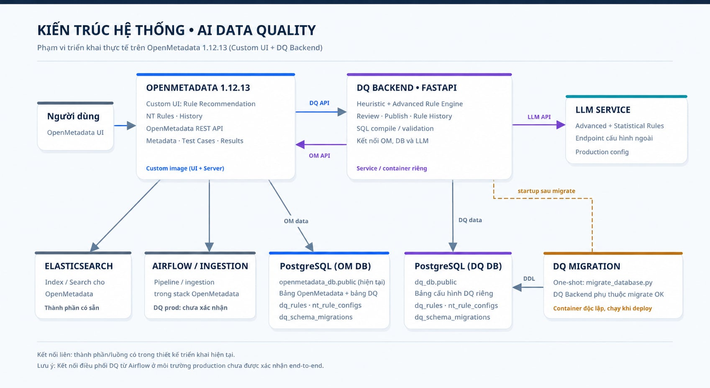

# Data Quality Rule Recommender & Observability System

> **Hệ thống Tự động Gợi ý, Quản lý và Đồng bộ Data Quality Rules tích hợp OpenMetadata & LLM**  
> Phiên bản: `1.0.0` (Nhánh `feature/upgrade-advance`)

---

## Giới thiệu tổng quan

**Data Quality Rule Recommender** là giải pháp toàn diện giúp tự động hóa quá trình phát hiện, gợi ý, thẩm định và quản lý các quy tắc chất lượng dữ liệu (Data Quality Rules). Hệ thống kết hợp giữa **Heuristics / Thống kê**, **Quy tắc chuẩn hóa nghiệp vụ (NT Rules)** và **Trí tuệ nhân tạo (LLM Router & Specialized Generators)** nhằm tạo ra các bộ quy tắc chất lượng cao, có thể giải thích được và đồng bộ trực tiếp vào nền tảng siêu dữ liệu **OpenMetadata**.

### Điểm nổi bật của phiên bản Upgrade Advance:
- **Hybrid Rule Engine**: Kết hợp Basic Engine (Not Null, Unique, Between, In-Set, Length, Row Count, Regex), Statistical Engine (Mean/Median drift), Advanced LLM Engine (Temporal, Cross-Column, Conditional Dependency) và NT Rules Engine.
- **Tích hợp OpenMetadata Live 100%**: Đọc schema, profiling, lineage trực tiếp từ OpenMetadata API và xuất bản ngược lại dưới dạng các Test Case chuẩn hóa.
- **Multi-Dialect SQL Transpiler & Validator**: Tự động sinh cú pháp SQL kiểm tra dữ liệu tương thích với PostgreSQL, Snowflake, BigQuery, MySQL, SQLite... cùng cơ chế kiểm định cú pháp nghiêm ngặt trước khi áp dụng.
- **Human-in-the-Loop Workflow**: Giao diện trực quan cho Data Steward/Engineer duyệt (Accept), tinh chỉnh tham số (Edit), từ chối (Reject) và theo dõi lịch sử phiên bản.

---

## Kiến trúc hệ thống

<p align="center">
  
</p>

---

## Các tính năng chính

### 1. Multi-tier Rule Engines
* **Basic Rule Engine**: Tự động phát hiện các ràng buộc cơ bản dựa trên metadata và profiling (tỷ lệ null, cardinality, min/max, độ dài chuỗi, định dạng regex email/phone/date).
* **Statistical Rule Engine**: Theo dõi lịch sử profiling theo chuỗi thời gian, áp dụng thuật toán tiền lọc (Pre-filter) và LLM Reviewer để phát hiện độ lệch bất thường của Mean / Median / Standard Deviation.
* **Advanced Rule Engine (LLM-Powered)**:
  * **Router**: Phân tích ngữ cảnh bảng, tên cột, ràng buộc để định tuyến các nhóm rule tiềm năng với ngưỡng tin cậy (Confidence $\ge 0.6$).
  * **Temporal Generator**: Sinh rule kiểm tra quan hệ thời gian (ví dụ: `start_date <= end_date`, `birth_date <= death_date`).
  * **Cross-Column Generator**: Ràng buộc logic giữa nhiều cột (ví dụ: `paid_amount <= total_amount`).
  * **Conditional Dependency Generator**: Ràng buộc có điều kiện (ví dụ: `IF status = 'COMPLETED' THEN completed_at IS NOT NULL`).
* **NT Standard Rules Engine**: Khung cấu hình quy tắc chuẩn theo định dạng Declarative JSON/YAML, hỗ trợ bộ đánh giá (Evaluators) và quản lý job thực thi tự động.

### 2. Thẩm định & Đối chiếu (Validation & Reconciliation)
* **Type & Column Safety**: Kiểm tra cột tồn tại, tương thích kiểu dữ liệu (tránh áp dụng rule số cho cột văn bản).
* **Existing Rule Reconciler**: Tự động quét các Test Case đã có trên OpenMetadata để tránh trùng lặp, đánh dấu trạng thái *NEW*, *EXISTING* hoặc *MODIFIED*.
* **SQL Transpiler**: Chuyển đổi biểu thức logic sang SQL hợp lệ, tương thích với nhiều hệ quản trị cơ sở dữ liệu qua thư viện `sqlglot`.

### 3. Đồng bộ hai chiều với OpenMetadata
* Lấy danh sách Services, Databases, Schemas, Tables.
* Phân tích Schema chi tiết, Cột, Khóa chính/ngoại, Tags, Tier dữ liệu.
* Đọc Freshness và Profiling trực tiếp.
* Xuất bản (Publish) các Rule đã được phê duyệt thành các Test Case chính thức gắn vào Test Suite trên OpenMetadata.

### 4. Giao diện người dùng (Custom OpenMetadata UI)
* Tích hợp trực tiếp vào nền tảng OpenMetadata (phiên bản 1.12.13) thông qua gói giao diện mở rộng (Custom UI Extension).
* **Table Context & Observability**: Xem chi tiết tổng quan bảng, schema, dữ liệu mẫu, column profiling, freshness và lineage upstream/downstream trực tiếp trên OpenMetadata.
* **Recommendation Board**: Bảng gợi ý luật chất lượng dữ liệu được phân loại rõ ràng (Basic, Statistical, Advanced, NT Rules), kèm độ tin cậy (Confidence Score), lý do đề xuất và biểu thức truy vấn SQL vi phạm.
* **Human-in-the-Loop Review**: Thao tác Duyệt (Accept), Sửa tham số (Edit) trực tiếp, Từ chối (Reject) kèm ghi chú, xem lịch sử phiên bản và đồng bộ ngược vào Test Cases/Test Suite của OpenMetadata.

---

## Cấu trúc thư mục dự án

```text
├── backend/                        # Mã nguồn Backend FastAPI
│   ├── api/router/                 # Các API Endpoints (datasource, recommendation, review, test_cases...)
│   ├── config/                     # Cấu hình hệ thống (Pydantic Settings, .env)
│   ├── contracts/                  # Data models, DTOs & Schemas (Pydantic)
│   ├── datasource/                 # Kết nối nguồn dữ liệu (PostgreSQL, OpenMetadata)
│   ├── engine/                     # Các bộ sinh quy tắc (Basic, Advanced LLM, Statistical, NT Rules)
│   │   ├── adapters/               # Adapter chuẩn hóa output giữa các engine
│   │   ├── advanced_llm/           # Client LLM, Router và các Generators chuyên biệt
│   │   ├── nt_rules/               # Engine quy tắc chuẩn hóa NT
│   │   ├── prompts/                # Các file prompt Markdown tối ưu cho LLM
│   │   ├── sql_mapper/             # SQL Dialect Transpiler & Validator
│   │   └── statistical_rules/      # Engine phát hiện bất thường thống kê
│   ├── evaluation/                 # Công cụ đo lường và đánh giá chất lượng rule
│   ├── integrations/               # Tích hợp OpenMetadata (Client, Publisher, Syncer)
│   ├── repository/                 # Data access layer
│   ├── review/                     # Logic xử lý Human Review
│   ├── services/                   # Business logic services & Background Job Runners
│   ├── storage/                    # Quản lý Database PostgreSQL (Neon / Local) & Migrations
│   ├── validator/                  # Bộ lọc và đối chiếu rule (Reconciler, Schema Validator)
│   └── main.py                     # Entry point khởi chạy FastAPI app
├── data/                           # Dataset mẫu, Golden Set đánh giá, sample profile
├── migrations/                     # Script khởi tạo và cập nhật cấu trúc database
├── scripts/                        # Scripts tự động hóa (migration, benchmark, import dữ liệu)
├── tests/                          # Automated Unit & E2E Test Suite (pytest)
├── Dockerfile                      # Docker containerfile cho backend
├── docker-compose.local-db.yml     # Khởi chạy PostgreSQL cục bộ qua Docker
├── kien_truc_he_thong.jpg          # Hình ảnh sơ đồ kiến trúc hệ thống
└── requirements.txt                # Danh sách thư viện Python
```

---

## Yêu cầu hệ thống

- **Python**: `>= 3.10` (Khuyên dùng `3.12`)
- **Node.js**: `>= 18.0.0` (Khuyên dùng `20+`)
- **Database**: PostgreSQL 15+ (Local Docker hoặc dịch vụ đám mây như Neon)
- **OpenMetadata Server**: Phiên bản 1.2+ (Đã cấu hình JWT Token)
- **LLM Endpoint**: Ollama (chạy model `gemma4-e2b`, `deepseek-coder`, ...) hoặc bất kỳ endpoint tương thích OpenAI API.

---

## Hướng dẫn cài đặt & Khởi chạy

### 1. Cấu hình môi trường (`.env`)

Sao chép file mẫu và điền các thông tin kết nối thực tế trong thư mục `backend/`:

```bash
cp backend/.env.example backend/.env
```

Nội dung cấu hình quan trọng trong `backend/.env`:
```ini
# OpenMetadata Connection
OM_API=https://your-openmetadata-server.com
OM_TOKEN=your-openmetadata-om-jwt-token-here
BOT_TOKEN=your-openmetadata-bot-jwt-token-here
OM_TIMEOUT=30

# Neon PostgreSQL Database for Rule Storage (Shared)
DATABASE_URL=replace-with-your-neon-url
POSTGRES_HOST=replace-with-your-neon-host
POSTGRES_PORT=replace-with-your-neon-port
POSTGRES_USER=replace-with-your-neon-user
POSTGRES_PASSWORD=replace-with-your-neon-password
POSTGRES_DB=replace-with-your-neon-db
POSTGRES_SSLMODE=require
POSTGRES_CONNECT_TIMEOUT=10

# LLM provider (OpenAI-compatible Gemma endpoint / DeepSeek)
LLM_API=ollama
# Use an address reachable from the DQ backend container. Do not use localhost
# unless the model server runs in the same container.
LLM_BASE_URL=http://your-llm-host:11434/v1
LLM_MODEL=gemma4-e2b
LLM_TIMEOUT_SECONDS=600
LLM_MAX_RETRIES=1
LLM_MAX_TOKENS=8192

# Default Target Scope
FQN=healthcare_postgres.HealthCare.public

# Application Environment
APP_ENV=development

# Go-live engine scope
ENABLE_ADVANCED_RULES=true
ENABLE_STATISTICAL_RULES=false
```

---

### 2. Khởi chạy Database cục bộ (Tùy chọn)

Nếu không sử dụng Neon Cloud Database, bạn có thể khởi chạy PostgreSQL cục bộ bằng Docker:

```bash
docker compose -f docker-compose.local-db.yml up -d
```
Cơ sở dữ liệu sẽ lắng nghe tại cổng `5433`.

Chạy migration để khởi tạo bảng dữ liệu:
```bash
python scripts/migrate_database.py
```

---

### 3. Cài đặt và Khởi chạy Backend

1. Tạo và kích hoạt môi trường ảo:
   ```bash
   # Windows (PowerShell)
   python -m venv .venv
   .venv\Scripts\activate

   # Linux / macOS
   python3 -m venv .venv
   source .venv/bin/activate
   ```

2. Cài đặt các thư viện phụ thuộc:
   ```bash
   pip install --upgrade pip
   pip install -r requirements.txt
   ```

3. Khởi chạy server FastAPI:
   ```bash
   python -m uvicorn backend.main:app --host 127.0.0.1 --port 8000 --reload
   ```
   * Tài liệu Swagger API tương tác: [http://127.0.0.1:8000/docs](http://127.0.0.1:8000/docs)
   * Redoc API: [http://127.0.0.1:8000/redoc](http://127.0.0.1:8000/redoc)

---

### 4. Khởi chạy Giao diện Custom OpenMetadata UI

Giao diện người dùng được tích hợp trực tiếp vào OpenMetadata UI (phiên bản 1.12.13):

1. Di chuyển vào thư mục mã nguồn UI của OpenMetadata:
   ```bash
   cd openmetadata-ui/src/main/resources/ui
   ```

2. Cài đặt các gói phụ thuộc (nếu chạy lần đầu):
   ```bash
   yarn install
   ```

3. Khởi chạy giao diện OpenMetadata:
   ```bash
   yarn start
   ```
   * Ứng dụng OpenMetadata UI sẽ khởi chạy tại: `http://localhost:3000`
   * Toàn bộ tính năng Rule Recommender, NT Rules, Lineage, Test Cases và Human Review sẽ hiển thị trực tiếp trên giao diện của từng Table trong OpenMetadata.

---

## Kiểm thử tự động (Automated Testing)

Hệ thống có bộ test tự động kiểm tra toàn bộ luồng từ Engine đến API:

```bash
python -m pytest tests/ -v
```

Kiểm tra riêng các module trọng tâm:
```bash
# Kiểm thử Basic Engine & E2E flow
python -m pytest tests/test_basic_engine.py tests/test_end_to_end_flow.py -v

# Kiểm thử Advanced Rule LLM Router & Generators
python -m pytest tests/advanced_rules/ -v

# Kiểm thử SQL Dialect Transpiler
python -m pytest tests/sql_mapper/ -v

# Kiểm thử NT Rules Engine
python -m pytest tests/test_nt_phase_c.py -v
```

---

## Danh sách API Endpoints chính

| Phương thức | Đường dẫn | Chức năng |
|:---|:---|:---|
| `GET` | `/api/v1/health` | Kiểm tra trạng thái hệ thống và kết nối OpenMetadata |
| `GET` | `/api/v1/catalog/tables` | Lấy danh sách bảng từ OpenMetadata |
| `GET` | `/api/v1/context/{table_fqn}` | Lấy chi tiết schema, column profile, lineage của bảng |
| `POST` | `/api/v1/recommendations/generate` | Sinh danh sách rule gợi ý (Basic + Advanced) |
| `POST` | `/api/v1/review/{candidate_id}` | Thực hiện hành động Review: `ACCEPT`, `EDIT`, `REJECT` |
| `POST` | `/api/v1/test-cases/publish` | Đẩy các rule đã duyệt lên OpenMetadata dưới dạng Test Cases |
| `GET` | `/api/v1/evaluation/summary` | Lấy báo cáo thống kê benchmark chất lượng rule |
| `POST` | `/api/v1/jobs/generation` | Tạo và quản lý background job sinh rule cho nhiều bảng |
| `GET` | `/api/v1/nt-rules` | Danh sách và trạng thái cấu hình bộ quy tắc chuẩn NT |

---

## Bản quyền & Giấy phép

Dự án được phát hành dưới giấy phép mã nguồn mở nội bộ phục vụ mục đích nghiên cứu và phát triển giải pháp Quản trị Chất lượng Dữ liệu (Data Quality & Observability).
