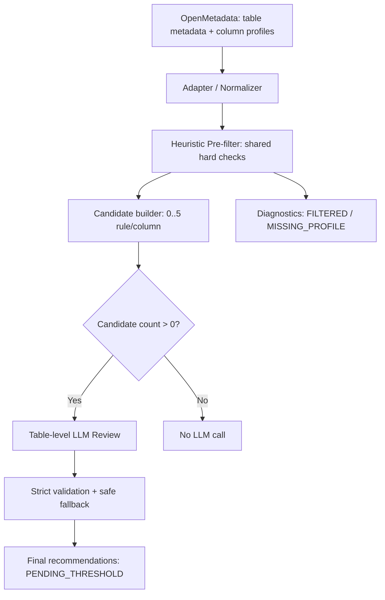

# Implementation Plan — 5 Statistical Rules: Heuristic Pre-filter → LLM Review

**Version:** 1.0 — Simplified POC  
**Date:** 2026-10-12  
**Feature:** Automatic Statistical DQ Rule Recommendation  
**Rules:** Mean, Median, StdDev, Min, Max  
**Target:** Mở rộng tính năng Mean/Median đang triển khai, không xây lại engine hoặc ép cấu trúc thư mục.

> **YÊU CẦU CHO CODEX:** Đọc code hiện tại trước khi thay đổi, đặc biệt code Mean/Median chưa chắc đã được commit/push lên GitHub. Dùng trực tiếp abstractions, contracts, adapters, LLM client, API, tests đang có. Tài liệu này quy định **hành vi**, không cố định folder/class. Nếu logic trong code Mean/Median đang là `AUTO_ACCEPT`, `OPTIONAL`, scoring nhiều nhánh thì **đơn giản hóa** theo plan này, không tạo song song hai pipeline.

---

## 0. Mục tiêu, phạm vi, nguyên tắc

### Mục tiêu

Từ table metadata + column profiling do OpenMetadata cung cấp:

1. **Heuristic Pre-filter** loại các cột/rule **không đủ điều kiện bắt buộc**.
2. Gửi **danh sách cặp `(column, rule_type)` hợp lệ**, cộng toàn bộ *schema metadata của bảng* và profiling cần thiết, cho **LLM review theo bảng**.
3. LLM xác định rule nào **đáng đề xuất** xét theo ngữ nghĩa nghiệp vụ, đặc trưng thống kê và sự bổ sung với rule đang có; cho phép `UNCERTAIN`.
4. Backend kiểm tra tính hợp lệ của output và trả danh sách rule candidates cuối cùng **chờ xác định threshold**.

### Không làm trong version này

- Không tạo `minValue`, `maxValue` hay học dynamic threshold.
- Không push/run Test Case trên OpenMetadata; không chạy DQ Validation.
- Không auto-accept candidate chỉ dựa trên profile.
- Không heuristic semantic score/phân tầng `AUTO_ACCEPT`, `OPTIONAL`, `HIGH_PRIORITY`.
- Không bắt buộc tính CV, IQR-based skew, tail gaps hoặc so ngưỡng skew để pass pre-filter.
- Không query lại raw data để tự tính metric mà OM đã cung cấp.
- Không sửa 5 Basic Rules đã hoàn thành; không làm lại Advanced Router/Generator.
- Không suy luận rằng đề xuất của LLM tương đương yêu cầu nghiệp vụ đã được phê duyệt.

### Nguyên tắc thiết kế

- **High Recall:** chỉ loại khi có bằng chứng rõ ràng không hợp lệ; phần còn mơ hồ đi LLM.
- **Rule granularity:** lọc theo **cặp `(column, rule_type)`**, vì cùng một cột có thể thiếu Median nhưng có Mean.
- **Single table-level LLM review:** một call/bảng trong trường hợp vừa context; batch theo cột nếu table quá lớn.
- **No threshold leakage:** `min` và `max` từ profiling chỉ là *giá trị quan sát*, không phải `minValue`/`maxValue` cho rule.
- **Traceability:** mỗi candidate có lý do qua/lọc; output LLM phải liên hệ chính xác candidate đầu vào.

---

## 1. Danh sách 5 rule và metric bắt buộc

| Rule type (OpenMetadata) | Điều kiện metric riêng | Kết quả cần giám sát trong tương lai |
|---|---|---|
| `columnValueMeanToBeBetween` | `mean` hiện diện, hữu hạn | Mean của column |
| `columnValueMedianToBeBetween` | `median` hiện diện, hữu hạn | Median của column |
| `columnValueStdDevToBeBetween` | `stddev` hiện diện, hữu hạn, số quan sát hợp lệ >= 2 | Standard deviation |
| `columnValueMinToBeBetween` | `min` hiện diện, numeric, hữu hạn | Giá trị nhỏ nhất của column |
| `columnValueMaxToBeBetween` | `max` hiện diện, numeric, hữu hạn | Giá trị lớn nhất của column |

Đây là **5 tên Test Definition chính xác để dùng trong candidate**; không đặt tên tùy ý `MeanRule` khi xuất cho OpenMetadata.

### Điều kiện chung (hard filter) áp dụng cho từng cột

| ID | Điều kiện | Kết luận khi không thỏa |
|---|---|---|
| C1 | Datatype thật sự thuộc numeric family (integer, decimal, float/double, real...) | `FILTERED_NON_NUMERIC` |
| C2 | **Không có bằng chứng chắc chắn** cột là PK/FK/identifier/code được mã hóa numeric | `FILTERED_IDENTIFIER_OR_CODE` |
| C3 | Có ít nhất 1 giá trị numeric không-null hợp lệ trong profile | `FILTERED_NO_VALID_VALUES` hoặc `MISSING_PROFILE` |
| C4 | Có profile OM đáng tin cậy và field cho rule không bị thiếu/NaN/Infinity | `MISSING_PROFILE_METRIC` / `INVALID_PROFILE_METRIC` |

**Ngoại lệ cho StdDev:** yêu cầu ít nhất **2 quan sát numeric hợp lệ** để StdDev có cơ sở tính; stddev `0.0` **vẫn hợp lệ**. Nếu không xác minh được count, đánh dấu thiếu bằng chứng; không tự suy từ `row_count` khi bảng có null.

**Không dùng** `valuesCount >= 30`, `distinctCount >= 10`, `stddev > 0`, `mean ≈ median`, `skew >= 0.3`, `min < max`, `tail_gap > 3` làm điều kiện bắt buộc.

### Xác định identifier/code (C2) theo hướng thận trọng

1. Verified PK/FK constraint hoặc metadata `identifier`/`code` rõ ràng → lọc.
2. Name/description rất rõ nghĩa ID/code (`patient_id`, `zip`, `fips`, `status_code`, `postal_code`...) và không mâu thuẫn → có thể lọc.
3. **Không** lọc chỉ vì `distinct_ratio` cao (một phép đo có thể unique).
4. **Không** lọc chỉ vì `distinct_count` thấp (số lần khám vẫn là phép đo dạng đếm).
5. Tên chung chung như `value`, `score`, `coverage`, `number` hoặc name/description mâu thuẫn → **giữ lại** để LLM xét; không đoán.
6. Tokenize snake_case/camelCase theo từ, tránh substring match sai (`id` nằm giữa một từ dài).

C2 là bộ lọc **chắc chắn loại**, không phải một semantic model nhiều nhánh. Rule *nào phù hợp nghiệp vụ* sẽ do LLM review.

---

## 2. Luồng tổng thể



**Thứ tự cố định:**

`Load context → Normalize → Hard filter → Build eligible pairs → Prepare table LLM context → Review → Validate → Deduplicate → Return`

Không cần module scoring riêng hoặc 5 semantic selector phức tạp ở phase này.

---

## 3. Module A — OpenMetadata adapter / normalize

### 3.1. Tái sử dụng phần Mean/Median đang code

- Tìm **active** `TableContext`/`ColumnProfile`/OpenMetadata client trong repo đang chạy; tái sử dụng thay vì xây client khác.
- Mở rộng optional fields chỉ nếu code Mean/Median chưa có đầy đủ.
- Reuse LLM client, settings, logging, review service/DTO hiện hành nếu phù hợp.
- Nếu Mean/Median đã hoạt động, thêm StdDev/Min/Max vào registry/config thay vì copy nguyên pipeline.

### 3.2. Fields cần giữ từ OM

| Nguồn | Trường | Bắt buộc cho điều gì? |
|---|---|---|
| Table metadata | `table_fqn`, name, description | Semantic context và dedup |
| Column metadata | name, datatype, description, nullable, PK/FK, tags/glossary (nếu có) | Filter + LLM context |
| Column profile | `timestamp`, `valuesCount`, `validCount` nếu có, `nullCount`, `distinctCount`, `distinctProportion` | Data availability + context |
| Column profile | `mean`, `median`, `stddev`, `min`, `max` | 5 điều kiện metric bắt buộc |
| Column profile | `firstQuartile`, `thirdQuartile`, `interQuartileRange`, `nonParametricSkew` nếu có | Evidence gửi LLM, **không dùng lọc bắt buộc** |
| Existing metadata | existing DQ test cases/rules, nếu đã có trong `TableContext` | Giúp LLM xét overlap, backend chống rule trùng |
| Provenance | profile timestamp, source, scope/sampling nếu xác minh được | Tránh dùng mock/scope không rõ làm dữ liệu thật |

- **OM đã trả metric thì không tính lại** từ SQL hoặc từ data gốc; chỉ map field.
- `firstQuartile`, `thirdQuartile`, `interQuartileRange`, `nonParametricSkew`: optional. Thiếu không làm hỏng 5 core metrics.
- `validCount`, `valuesCount`, `rowCount` có thể mang ngữ nghĩa khác nhau: xác nhận theo schema/payload instance thật, không tự quy đồng.
- Metric **0 là hợp lệ** (`mean=0`, `median=0`, `stddev=0`, `min=0`, `max=0`). Không dùng `value or default` vì sẽ làm mất giá trị 0.
- Reject/diagnostic metric `NaN`, `+Inf`, `-Inf`, text không parse được; tránh lỗi JSON serialization.
- Fallback demo/mock trong client **không** được đối xử như profile thực khi feature chạy live.
- Ghi `MISSING_PROFILE` khi OM chưa chạy profiler hoặc metric chưa có; không lén chạy thêm SQL.

**Kiểm tra kỹ thuật trước khi code:** dump một payload **đã khử dữ liệu nhạy cảm** từ instance OM 2.0.2 để xác nhận tên field (`stddev`, `median`, `min`, v.v.) và metric có thực sự được tính không. Nếu chưa có, chỉ báo missing — không tự giả lập.

---

## 4. Module B — Heuristic Pre-filter

### 4.1. Trả về gì?

```json
{
  "table_fqn": "healthcare_postgres.HealthCare.public.patients",
  "column": "healthcare_expenses",
  "eligible_rules": [
    "columnValueMeanToBeBetween",
    "columnValueMedianToBeBetween",
    "columnValueStdDevToBeBetween",
    "columnValueMinToBeBetween",
    "columnValueMaxToBeBetween"
  ],
  "filtered_rules": [],
  "reason_codes": ["NUMERIC", "NOT_IDENTIFIER", "VALID_PROFILE"]
}
```

- Một cột có 0–5 rule pairs đủ điều kiện.
- `filtered_rules` lưu **theo rule** để giải thích metric nào bị thiếu.
- Khi tất cả rule bị lọc → không gửi cột đó trong `columns_to_review`, nhưng vẫn có thể để **metadata ngắn gọn** của cột trong `table_schema`.

### 4.2. Thuật toán Python dạng tham chiếu

```python
RULE_TO_PROFILE_FIELD = {
    "columnValueMeanToBeBetween": "mean",
    "columnValueMedianToBeBetween": "median",
    "columnValueStdDevToBeBetween": "stddev",
    "columnValueMinToBeBetween": "min_value",
    "columnValueMaxToBeBetween": "max_value",
}


def build_eligible_pairs(column, profile):
    # Adapt helpers to the existing repository contracts.
    if not is_numeric_type(column.data_type):
        return [], "FILTERED_NON_NUMERIC"

    if is_verified_identifier_or_code(column):
        return [], "FILTERED_IDENTIFIER_OR_CODE"

    n = get_verified_non_null_numeric_count(profile)  # None if unknown
    if n is None:
        return [], "MISSING_VALID_COUNT"
    if n == 0:
        return [], "FILTERED_NO_VALID_VALUES"

    eligible = []
    filtered = []
    for rule_type, field in RULE_TO_PROFILE_FIELD.items():
        value = getattr(profile, field, None)
        if not is_finite_number(value):
            filtered.append({"rule_type": rule_type,
                             "reason": "MISSING_OR_INVALID_PROFILE_METRIC"})
            continue
        if rule_type == "columnValueStdDevToBeBetween" and n < 2:
            filtered.append({"rule_type": rule_type,
                             "reason": "INSUFFICIENT_VALUES_FOR_STDDEV"})
            continue
        eligible.append(rule_type)

    return eligible, filtered
```

**Implement actual API bằng typed DTO/Pydantic** thay vì trả các type hỗn hợp như pseudo-code. Chỉ có 3 kết quả pre-filter đơn giản: `ELIGIBLE`, `FILTERED`, `MISSING_PROFILE` (có reason code); **không** `AUTO_ACCEPT`/`OPTIONAL`/`PRIORITY`.

### 4.3. Những trường hợp cần test

- `mean=0`, `stddev=0`, `min=0`: **được giữ** nếu đủ mẫu.
- Median thiếu nhưng Mean có → chỉ lọc Median, giữ Mean.
- StdDev có nhưng chỉ 1 numeric observation → chỉ lọc StdDev.
- PK numeric, code numeric được xác nhận → loại toàn bộ 5 rule, không gọi LLM cho cột.
- `number_of_visits` ít distinct nhưng được mô tả là count → **không loại**.
- `value` numeric thiếu description → **giữ lại**, cần table context cho LLM.
- Tất cả numeric metric có nhưng `profile_source=MOCK` → không coi là live candidates.
- Không được thực hiện `AVG/MEDIAN/STDDEV/PERCENTILE` SQL trong bộ lọc.

---

## 5. Module C — Tạo context LLM cấp table

### 5.1. Một payload gồm 3 phần

1. **Rule definitions**: 5 rule supported, ý nghĩa rule, cách phân biệt, đặc biệt Mean/Median/StdDev/Min/Max **không đồng nghĩa nhau**.
2. **Table schema toàn bộ**: table name/description, các column `{name, datatype, description, PK/FK, tags (nếu có)}` kể cả cột không eligible để LLM biết ngữ cảnh.
3. **Eligible column details**: chỉ các cột pass pre-filter được gửi *profiling chi tiết*, cùng danh sách `eligible_rules` đã lọc và optional existing rules.

**Không gửi** profiling chi tiết của các cột non-numeric, ID/code đã loại (trừ khi cần ngữ cảnh, và phải tối giản). Không gửi raw rows, bệnh án, tên bệnh nhân hoặc các mẫu giá trị nhạy cảm.

### 5.2. JSON input ví dụ (số liệu giả định)

```json
{
  "table": {
    "fqn": "healthcare_postgres.HealthCare.public.patients",
    "name": "patients",
    "description": "Patient demographics and cumulative costs"
  },
  "supported_rules": [
    {"type": "columnValueMeanToBeBetween", "meaning": "Monitor average"},
    {"type": "columnValueMedianToBeBetween", "meaning": "Monitor median"},
    {"type": "columnValueStdDevToBeBetween", "meaning": "Monitor dispersion"},
    {"type": "columnValueMinToBeBetween", "meaning": "Monitor observed minimum"},
    {"type": "columnValueMaxToBeBetween", "meaning": "Monitor observed maximum"}
  ],
  "table_schema": [
    {"name": "id", "datatype": "UUID", "is_pk": true},
    {"name": "birthdate", "datatype": "DATE"},
    {"name": "healthcare_expenses", "datatype": "NUMERIC",
     "description": "Total lifetime healthcare expenses"},
    {"name": "healthcare_coverage", "datatype": "NUMERIC",
     "description": "Healthcare costs covered by insurance"}
  ],
  "columns_to_review": [
    {
      "name": "healthcare_expenses",
      "profile": {
        "values_count": 10000,
        "distinct_count": 9500,
        "mean": 8500,
        "median": 4200,
        "stddev": 12000,
        "min": 0,
        "max": 150000,
        "q1": 2000,
        "q3": 6000
      },
      "eligible_rules": [
        "columnValueMeanToBeBetween",
        "columnValueMedianToBeBetween",
        "columnValueStdDevToBeBetween",
        "columnValueMinToBeBetween",
        "columnValueMaxToBeBetween"
      ]
    }
  ],
  "existing_rules": ["columnValuesToBeBetween on healthcare_expenses"]
}
```

### 5.3. Xử lý table nhiều cột

- **Mặc định**: một LLM call / table.
- Nếu payload quá dài, chia `columns_to_review` thành batches (chẳng hạn 10–20 cột/batch theo token budget) và lặp lại `table_schema` rút gọn + rule definitions trong mỗi batch.
- Không cắt ngang JSON, không mất eligible pair; sau đó merge output theo `(column, rule_type)`.
- Không gộp khác table, không rút bỏ ngữ nghĩa cần thiết của cột đang review.
- Chỉ lấy metadata thật sự có trong catalog; tags, owner, glossary thiếu thì bỏ, không tự bịa.

---

## 6. Module D — LLM Semantic Rule Reviewer

### 6.1. Vai trò

Với **mỗi eligible `(column, rule_type)`**, đưa ra một trong 3 quyết định:

- `RECOMMEND`: Rule có ý nghĩa để theo dõi chất lượng/phân phối của dữ liệu; có khả năng mang lại tín hiệu có ích.
- `SKIP`: Rule không có nhiều ý nghĩa giám sát, không phù hợp ngữ nghĩa, hoặc bổ sung quá ít so với rule hiện có (cần giải thích).
- `UNCERTAIN`: Không đủ bằng chứng nghiệp vụ để kết luận.

Đây là **đánh giá tính phù hợp của rule**, không phải xác nhận nghĩa vụ bắt buộc trong chính sách DQ của doanh nghiệp.

### 6.2. Hướng dẫn phân biệt 5 rule trong prompt

- **Mean**: phát hiện thay đổi của giá trị trung bình; nhạy với cực trị; không tự reject vì dữ liệu lệch.
- **Median**: giá trị giữa/điển hình, ít nhạy với cực trị; có thể bổ sung Mean; không yêu cầu skew mới được đề xuất.
- **StdDev**: đo mức phân tán; có ích nếu theo dõi dispersion mang ý nghĩa đối với đại lượng; `stddev=0` vẫn có thể được giám sát.
- **Min**: theo dõi giá trị nhỏ nhất theo phạm vi profiling; có thể nhiễu do outlier; hỏi liệu cực trị dưới đáng theo dõi hay không.
- **Max**: tương tự cho cực trị trên; không mặc định cần thiết vì `max` cao.
- Với **Min/Max**, xem `existing_rules` (đặc biệt `columnValuesToBeBetween`) để xét giá trị bổ sung; **không** tự khẳng định trùng chính xác khi chưa biết threshold và scope.
- Một cột có thể được đề xuất 0–5 rule; không bắt buộc cân đối số lượng hay chọn một rule duy nhất.
- LLM không được invent business policy, thresholds, dữ liệu lịch sử hoặc nhãn lỗi.

### 6.3. Prompt tiếng Anh gợi ý (đưa vào file prompt hiện có)

```text
You are a Data Quality Statistical Rule Reviewer.

TASK:
Review ONLY the eligible (column, rule_type) pairs supplied in the input.
Determine whether each proposed statistical monitoring rule is semantically
meaningful and useful for data quality monitoring, considering the full table
schema, column descriptions, aggregated profiling, and existing rules.

SUPPORTED RULES:
- columnValueMeanToBeBetween: monitor average
- columnValueMedianToBeBetween: monitor median
- columnValueStdDevToBeBetween: monitor dispersion
- columnValueMinToBeBetween: monitor minimum
- columnValueMaxToBeBetween: monitor maximum

DECISIONS:
- RECOMMEND: meaningful and potentially useful monitoring signal.
- SKIP: poor semantic fit or clearly negligible additional value.
- UNCERTAIN: not enough context to justify either conclusion.

RULES:
1. Output exactly one decision for EACH eligible (column, rule_type) pair.
2. Do NOT introduce columns or rules that are absent from eligible_rules.
3. Do NOT generate SQL, thresholds, minValue, maxValue, or test cases.
4. Do NOT confuse numeric identifiers/category codes with measurements.
5. Mean, median, stddev, min and max provide different signals; do not
   automatically recommend all five for every numeric measurement.
6. Do NOT require high skew, high variance, or extreme tails as necessary
   preconditions for recommending a rule.
7. Consider possible mixed units, mixed meanings, and aggregation scope.
8. Do not infer business mandates or data errors solely from current profiling.
9. Existing columnValuesToBeBetween can overlap with Min/Max monitoring,
   but exact redundancy depends on threshold and data scope.
10. If the evidence is insufficient, choose UNCERTAIN instead of guessing.
11. Keep each reason specific and concise, grounded in provided input.

RETURN STRICT JSON matching the configured Pydantic schema.
```

### 6.4. JSON output contract

Dùng `candidate_id` ổn định trong 1 lần request, liên hệ chính xác input; `decisions` chứa **đầy đủ cả RECOMMEND/SKIP/UNCERTAIN**, không chỉ recommendations.

```json
{
  "decisions": [
    {
      "candidate_id": "healthcare_expenses::columnValueMeanToBeBetween",
      "column": "healthcare_expenses",
      "rule_type": "columnValueMeanToBeBetween",
      "decision": "RECOMMEND",
      "reason": "Average expenses is interpretable for this monetary measure."
    },
    {
      "candidate_id": "healthcare_expenses::columnValueMinToBeBetween",
      "column": "healthcare_expenses",
      "rule_type": "columnValueMinToBeBetween",
      "decision": "UNCERTAIN",
      "reason": "No clear requirement to track the minimum monetary amount."
    }
  ]
}
```

Ví dụ trên chỉ minh họa **2 decisions**; output thật phải có **đủ mỗi eligible pair**.

**Không dùng LLM self-reported confidence để auto accept** trong v1. Nếu cần lưu confidence theo schema cũ, đánh dấu provenance/mặc định tương thích, không mô tả là xác suất chắc chắn.

---

## 7. Module E — Backend validation / merge / final output

### 7.1. Kiểm tra nghiêm ngặt bằng Pydantic

- `decision` chỉ thuộc `RECOMMEND | SKIP | UNCERTAIN`.
- `candidate_id`/`(column, rule_type)` phải nằm đúng trong `eligible_pairs` gửi cho LLM.
- Không trùng candidate, không thêm rule ngoài 5 supported, không đổi tên cột.
- Không có field threshold/SQL tự sinh ở payload final.
- Thiếu decision hoặc parse lỗi: không tự đánh dấu `RECOMMEND`; gán `UNCERTAIN` + `LLM_OUTPUT_INVALID`/`LLM_OUTPUT_MISSING`.
- Retry tối đa 1 lần khi JSON invalid/timeout nếu code hiện có đã có retry; fallback không làm hỏng cả table.
- LLM result **không thể override** các pair đã bị hard filter.

### 7.2. Dedup và existing rules

- Dedup candidate theo `(table_fqn, column_name, rule_type, profile_scope)`.
- Nếu đã tồn tại **cùng rule type trên cùng column/scope**, đánh dấu `ALREADY_EXISTS` và không đưa vào danh sách tạo mới; có thể bỏ khỏi LLM input để giảm token.
- Không coi `columnValuesToBeBetween` mặc định trùng tuyệt đối với `columnValueMinToBeBetween` hoặc `columnValueMaxToBeBetween` khi chưa có thông tin ngưỡng/scope. Chỉ cung cấp existing rule cho review.

### 7.3. Final output đề xuất

```json
{
  "table_fqn": "healthcare_postgres.HealthCare.public.patients",
  "summary": {
    "columns_scanned": 20,
    "eligible_columns": 2,
    "eligible_pairs": 10,
    "filtered_pairs": 0,
    "llm_calls": 1,
    "recommended_pairs": 4,
    "skipped_pairs": 5,
    "uncertain_pairs": 1
  },
  "recommendations": [
    {
      "column": "healthcare_expenses",
      "rule_type": "columnValueMeanToBeBetween",
      "decision": "RECOMMEND",
      "threshold_status": "PENDING_THRESHOLD",
      "parameters": {},
      "reason": "Average healthcare costs is meaningful to monitor.",
      "evidence": {"profile_source": "OPENMETADATA", "metric": "mean"}
    }
  ],
  "skipped": [],
  "uncertain": [],
  "filtered": [],
  "warnings": []
}
```

*Các số liệu ví dụ trong `summary` chỉ có tính minh họa.* Trong implementation thực tế, count phải khớp số pair thực sự và cách xử lý `ALREADY_EXISTS` phải nhất quán.

`recommendations` chỉ chứa `RECOMMEND`. `skipped`, `uncertain`, `filtered` được giữ ở `diagnostics`/response để dễ đánh giá.

Nếu cần convert sang `CandidateRule` hiện tại:
- Dùng rule type y nguyên tên OM.
- `parameters={}`; `threshold_status=PENDING_THRESHOLD` ở field/DTO thích hợp.
- Không gán `engine="ADVANCED"` giả; nếu schema hiện tại chưa hỗ trợ `STATISTICAL`, sửa contract một cách tương thích hoặc giữ DTO tách biệt rồi adapter sau.
- Không push Test Case khi thiếu threshold.

---

## 8. Service/orchestration pseudo-code

```python
async def recommend_statistical_rules(table_name: str, use_llm: bool = True):
    context = await get_existing_table_context(table_name)
    table = normalize_existing_context(context)

    eligible_pairs = []
    filtered = []
    for col in table.columns:
        pairs, diagnostics = prefilter_five_rules(col)
        eligible_pairs.extend(pairs)
        filtered.extend(diagnostics)

    eligible_pairs = remove_exact_existing_rule_duplicates(
        table, eligible_pairs
    )

    if not eligible_pairs:
        return build_response([], filtered, llm_calls=0)

    if not use_llm:
        return build_response(
            [], filtered, pending_review=eligible_pairs, llm_calls=0
        )

    llm_inputs = build_table_level_batches(
        table_schema=table.columns,
        eligible_pairs=eligible_pairs,
        candidate_profiles=table.profiles_for(eligible_pairs),
        existing_rules=table.existing_rules,
    )
    outputs = []
    for payload in llm_inputs:
        raw = await existing_llm_client.review(payload)
        outputs.extend(validate_or_mark_uncertain(raw, payload.eligible_pairs))

    outputs = validate_exact_pair_coverage(outputs, eligible_pairs)
    return build_response(
        recommendations=[x for x in outputs if x.decision == "RECOMMEND"],
        skipped=[x for x in outputs if x.decision == "SKIP"],
        uncertain=[x for x in outputs if x.decision == "UNCERTAIN"],
        filtered=filtered,
        llm_calls=len(llm_inputs),
    )
```

**Đây là pseudo-code, không phải import/class bắt buộc.** Nếu current service đang sync FastAPI thì giữ sync; nếu async thì giữ async. Không refactor chỉ để khớp ví dụ.

---

## 9. Kế hoạch triển khai phù hợp với code Mean/Median đang làm

### Phase 0 — Inspect & align (quan trọng nhất)

- [ ] Đọc code Mean/Median hiện có, kể cả thay đổi local chưa commit.
- [ ] Tìm luồng adapter → filter → selector → LLM → output và các tests.
- [ ] Tìm code semantic score, `AUTO_ACCEPT`, `OPTIONAL`, priority/skew/tail branches đang dùng.
- [ ] **Giữ những phần dùng được**; remove/bypass nhánh phức tạp chỉ khi không phục vụ v1.
- [ ] Kiểm tra API/FE/review service hiện có trước khi sửa schema.

**Exit:** xác định điểm mở rộng nhỏ nhất, không tạo engine thứ hai.

### Phase 1 — Chuẩn hóa profile và 5-rule registry

- [ ] Reuse OM fields hiện map cho Mean/Median.
- [ ] Bổ sung `stddev`, `min`, `max` nếu code chưa map.
- [ ] Bảo toàn nullable / zero / actual profile source / timestamp.
- [ ] Định nghĩa registry 5 rule → required profile field.
- [ ] Test mappable vs missing field dựa trên payload thật/mocked OM.

**Exit:** dữ liệu đủ để xét 5 rule mà không query DB tính lại.

### Phase 2 — Shared Heuristic Pre-filter

- [ ] Thực hiện C1/C2/C3 và metric-specific check; StdDev cần >=2 values.
- [ ] Tạo `eligible_pairs` và `filtered_diagnostics` có reason.
- [ ] Không scoring ngữ nghĩa, không CV/skew/tail threshold branch, không `AUTO_ACCEPT`.
- [ ] Test từng cột có thể pass một số rule và fail một số rule.

**Exit:** `use_llm=false` trả đúng danh sách candidate chờ review, không đề xuất tự động.

### Phase 3 — Table-level LLM reviewer

- [ ] Xây prompt 5 rule ở mục 6; payload gồm rule definitions + full table schema + profiled candidate columns.
- [ ] Dùng LLM client sẵn có, JSON output strict, `RECOMMEND/SKIP/UNCERTAIN` cho mọi pair.
- [ ] 1 call/table nếu context đủ nhỏ, batch theo token budget nếu lớn.
- [ ] Dùng mocks cho integration/unit test, không yêu cầu thật API khi chạy CI.

**Exit:** LLM chỉ thấy candidates pass pre-filter, không tự thêm rule khác.

### Phase 4 — Validation & integrations

- [ ] Validate output pair coverage, identity, decision enums, dedup.
- [ ] Convert kết quả RECOMMEND sang statistical candidate/DTO hiện có.
- [ ] Giữ `PENDING_THRESHOLD`, no push/run OM.
- [ ] Expose qua route hiện có hoặc route riêng theo conventions, tránh breaking API.
- [ ] Log counters/timing/LLM costs (không log token key, không gửi PII).

**Exit:** chạy end-to-end 5 rule không ảnh hưởng Basic/Advanced.

### Phase 5 — Evaluation & tuning

- [ ] Tạo bộ mẫu column/rule có ground truth thủ công trên `patients`, `observations`, `medications`, `encounters`, `claims`.
- [ ] Đo `filtered_columns`, `eligible_pairs`, `LLM_calls`, tokens, `RECOMMEND/SKIP/UNCERTAIN`, precision/recall với nhãn đã kiểm chứng.
- [ ] Theo dõi false reject do heuristic; **chỉ thêm rule-specific thresholds trong version sau khi có bằng chứng evaluation**.
- [ ] Ghi rõ trường hợp `observations.value` có nhiều loại quan sát/đơn vị; một rule trên toàn cột có thể không có ý nghĩa nếu chưa phân nhóm.

---

## 10. Unit/Integration test matrix tối thiểu

| ID | Test case | Expected pre-filter | Expected review |
|---|---|---|---|
| T01 | `patient_id` numeric + verified PK | 0 pairs | No LLM for column |
| T02 | `zip` numeric, confirmed postal code | 0 pairs | No LLM |
| T03 | `healthcare_expenses`, all 5 finite metrics | 5 pairs | LLM decides per pair |
| T04 | Numeric `value` without semantic description | 5 pairs if metrics available | LLM may `UNCERTAIN` |
| T05 | `number_of_visits`, low distinct, known count | 5 pairs if metrics available | Not filtered for cardinality |
| T06 | Numeric Mean = 0, Median = 0 | Mean/Median pairs pass | Valid 0 |
| T07 | Numeric StdDev = 0, count >= 2 | StdDev passes | Can be RECOMMEND or SKIP |
| T08 | Count = 1, numeric with mean/min/max | Mean/Min/Max pass; StdDev fails; Median if available | LLM handles pass only |
| T09 | Median absent, other 4 metrics present | 4 pairs | No Median review |
| T10 | `min=0`, `max=0` | Both Min/Max pass | 0 not missing |
| T11 | Numeric profile has NaN/Infinity | Reject relevant metric pair | Never send invalid JSON |
| T12 | No live profile / mock fallback | 0 live pairs | No LLM |
| T13 | Column dtype VARCHAR even with numeric-looking strings | 0 pairs | No implicit casting |
| T14 | Mean rule exists already for same column/scope | Skip exact duplicate, other eligible rules remain | No duplicated proposed Mean |
| T15 | Existing Between rule on numeric column | Min/Max still eligible, context includes Between | LLM evaluates overlap, no automatic hard reject |
| T16 | LLM returns unlisted column/rule | Validated out, error diagnostic | No acceptance |
| T17 | LLM omits 1 eligible pair | Pair becomes UNCERTAIN | No silent RECOMMEND |
| T18 | LLM unavailable/invalid JSON | All affected pairs UNCERTAIN | Pipeline returns safely |
| T19 | Table no eligible numeric columns | 0 pairs | `llm_calls=0` |
| T20 | Table 200 columns / context too large | All candidate pairs retained, chunked by column | Each candidate decided once |
| T21 | Mean and Median both eligible | Two distinct eligible pairs | Review separately, no forced both |
| T22 | Numeric column with mixed units/meanings indicated by table schema | eligible under simple heuristic | LLM flags UNCERTAIN or SKIP with segmentation reason |

**Ngoài các test này:** assertion `eligible_pairs = recommended + skipped + uncertain` sau khi bỏ exact-existing rules, cùng không xuất threshold hay tạo Test Case.

---

## 11. Definition of Done

- [ ] Đủ đúng 5 Test Definition names và candidate generation cho từng cột.
- [ ] Heuristic **chỉ hard filter**, không có auto accepted/optional/scoring priorities.
- [ ] Filter dùng đúng C1/C2/C3 + metric required + `n>=2` cho StdDev.
- [ ] Không loại dựa trên skew, outlier, stddev=0, `min=max`, low cardinality alone.
- [ ] Tái sử dụng OpenMetadata profiling, không tính lại core metrics từ SQL.
- [ ] LLM nhận **full table schema + profiled eligible columns + danh sách eligible rules**.
- [ ] Một call/table khi vừa context, có bounded batching khi quá dài.
- [ ] LLM trả decision **cho mọi eligible pair**, validated strict.
- [ ] No hallucinated columns/rules; invalid/missing responses → UNCERTAIN.
- [ ] Kết quả RECOMMEND có `PENDING_THRESHOLD`, `parameters={}`; không push OM.
- [ ] Không phá Mean/Median đang code và 5 Basic Rules hiện tại.
- [ ] Tests pass + báo cáo số cột giảm trước LLM + số candidate và LLM calls.

---

## 12. Prompt ngắn giao Codex

> Hãy **cập nhật và mở rộng code Statistical Rule Recommendation hiện có**, không viết lại framework Mean/Median. Làm theo `implementation_plan_5_statistical_rules_prefilter_llm.md`. Feature hỗ trợ 5 rule Mean/Median/StdDev/Min/Max; chung một Heuristic Pre-filter **chỉ dùng hard conditions** (numeric, không verified identifier/code, có dữ liệu hợp lệ, OM metric required hợp lệ; StdDev >=2 values). Mỗi cột sinh 0–5 eligible `(column, rule_type)` pairs. Sau đó build **một LLM review cấp table** gồm 5 rule definitions, toàn bộ table schema, và **chỉ profiling chi tiết của eligible columns**, để LLM trả `RECOMMEND/SKIP/UNCERTAIN` cho **mỗi eligible pair**. Strict Pydantic validation + safe fallback; không cho LLM tự thêm rule/cột. Reuse adapter, LLM client, API, output DTO và tests hiện hành; file/folder do codebase quyết định. Không tính lại profiling metric đã có ở OM, không sinh threshold, không push Test Case. Xóa/bypass logic AUTO_ACCEPT/OPTIONAL/semantic scoring phức tạp ở version này. Viết tests và báo cáo diffs cùng end-to-end sample trên `patients`.

---

## 13. Tài liệu tham chiếu

- OpenMetadata column test definitions: https://docs.open-metadata.org/v1.12.x/how-to-guides/data-quality-observability/quality/tests-yaml-column-tests
- OpenMetadata profiler metrics (v2.0.x): https://github.com/open-metadata/docs-om/blob/main/v2.0.x/how-to-guides/data-quality-observability/profiler/metrics.mdx
- OpenMetadata `table` / `columnProfile` schema: https://github.com/open-metadata/OpenMetadata/blob/main/openmetadata-spec/src/main/resources/json/schema/entity/data/table.json
- Repo dự án: https://github.com/manhndgenius/dq-rule-recommender-openmetadata

**Lưu ý tương thích:** Các link docs xác nhận định nghĩa tính năng; field nào đã được tính trong instance OpenMetadata thực tế phải được kiểm tra bằng payload. Tài liệu không giả định rằng tất cả profiler metrics đều đã bật hoặc client đang sử dụng đã map hết field.
