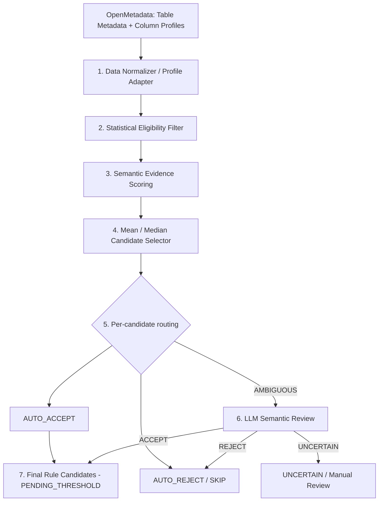

# Implementation Plan — Mean / Median Rule Recommendation

**Version:** 1.0  
**Date:** 2026-10-11  
**Target repository:** `manhndgenius/dq-rule-recommender-openmetadata`  
**Target backend:** Python / FastAPI / Pydantic / OpenMetadata 2.0.x  
**Feature:** Tự động đề xuất 2 rule `columnValueMeanToBeBetween` và `columnValueMedianToBeBetween`.

> **HƯỚNG DẪN CHO CODEX:** Hãy đọc repo hiện tại trước khi sửa code. Triển khai feature theo kiến trúc và acceptance criteria dưới đây; tái sử dụng service, contracts, config, LLM client, logging và hệ thống review có sẵn. Không refactor các engine khác trừ khi thật sự cần tương thích. Nếu code trên nhánh hiện tại đã thay đổi, ưu tiên kiến trúc đang chạy của repo hơn đường dẫn gợi ý trong tài liệu này.

---

## 0. Mục tiêu và giới hạn

### Mục tiêu

Từ `TableContext` chứa metadata và **column profiling lấy từ OpenMetadata**, quyết định cho mỗi cột:

1. Có đủ điều kiện kỹ thuật để xem xét Mean/Median rule không?
2. Mean/Median của cột có ý nghĩa ngữ nghĩa hay chỉ là ID/code/category được mã hóa bằng số?
3. Nên đề xuất `Mean`, `Median`, `cả hai`, hay `không đề xuất`?
4. Quyết định nào rõ ràng bằng heuristic và quyết định nào cần LLM semantic review?
5. Trả về danh sách *candidate rules* có giải thích, bằng chứng và trạng thái `PENDING_THRESHOLD` để xử lý ngưỡng ở feature sau.

### Ngoài phạm vi

- **KHÔNG** tính `minValue`/`maxValue` cảnh báo của Mean/Median.
- **KHÔNG** tạo, cập nhật, chạy Test Case hoặc Test Definition trên OpenMetadata.
- **KHÔNG** chạy SQL để tính lại các metric profiling OpenMetadata đã cung cấp.
- **KHÔNG** thiết kế historical baseline, drift detection, streaming hay anomaly model.
- **KHÔNG** đưa tất cả cột hoặc tất cả rule candidates vào LLM.
- **KHÔNG** dùng numeric `min`/`max` quan sát được làm ngưỡng Mean/Median.

### Hai tên Test Definition chính xác

| Rule | OpenMetadata Test Definition | Params khi xử lý ngưỡng ở phase sau |
|---|---|---|
| Mean | `columnValueMeanToBeBetween` | `minValueForMeanInCol`, `maxValueForMeanInCol` |
| Median | `columnValueMedianToBeBetween` | `minValueForMedianInCol`, `maxValueForMedianInCol` |

Không sử dụng `columnValuesToBeBetween` (rule kiểm tra từng giá trị) thay cho hai rule thống kê này.

---

## 1. Kiến trúc được chốt và thứ tự thực thi



**Bất biến kiến trúc:** **Rule Selector phải chạy TRƯỚC LLM Review.** LLM chỉ xét **candidate đã được heuristic sinh ra nhưng ngữ nghĩa còn chưa chắc chắn**, không tự động nghĩ ra thêm rule hoặc tự tính threshold.

---

## 2. Hiện trạng repo và điểm cần tích hợp

Đã đối chiếu các file trên nhánh `main` khi viết plan:

- `backend/contracts/table_context.py`: đang có `ColumnProfile` với `row_count`, `null_count`, `null_ratio`, `distinct_count`, `distinct_ratio`, `min_value`, `max_value`, `min_length`, `max_length`, `top_values`; **chưa chứa Mean, Median, Stddev, IQR, Quartiles, Skew, timestamp, profile source**.
- `backend/integrations/openmetadata/client.py`: có `_fetch_single_column_profile()` lấy profile mới nhất và `get_table_context()` map profile sang contract. **Dữ liệu raw có thể chứa metric nhưng adapter hiện không truyền qua các trường thống kê mới.**
- `backend/integrations/openmetadata_client.py`: có client legacy cùng chức năng. **Xác định import thực tế, không sửa cả hai client nếu không dùng.**
- `backend/engine/basic_engine.py`: có 5 basic rule hiện tại. **Giữ nguyên**.
- `backend/contracts/candidate_rule.py`: có `CandidateRule`; `engine` hiện là `Literal["BASIC", "ADVANCED"]`, `parameters` là dict.
- `backend/api/router/routes_recommendation.py`: luồng `POST /recommendations/generate` lấy `TableContext`, gọi BasicRuleEngine rồi lưu vào `review_service`.
- `backend/engine/advanced_rule_service.py`: đã có kiến trúc router/generator và LLM client cho advanced rules; **tái sử dụng client** cho semantic review, không tạo API client thứ hai.

**Quan trọng: tránh hai lỗi có sẵn khi bổ sung feature:**

1. Không coi `0` mặc định trong `ColumnProfile` là bằng chứng metric OM thực sự bằng 0; metric thiếu phải là `None` hoặc có trạng thái `MISSING` riêng.
2. Client có fallback dữ liệu minh họa/demo và đôi lúc suy ra `rowCount` từ cột. **Không dùng fallback/demo profiles để AUTO_ACCEPT statistical rules.** Trường hợp profile không lấy được từ OM: `INSUFFICIENT_PROFILE`, không giả vờ đã có metric thật.

### Quyết định tích hợp

- Tạo engine nhỏ độc lập `backend/engine/statistical_rules/`, không đưa vào Advanced Router/Generator.
- Giai đoạn đầu thêm **endpoint chuyên biệt** để demo/evaluate, tránh ảnh hưởng giao diện và BasicRuleEngine đang chạy.
- Sau khi test pass, nối vào `POST /recommendations/generate` qua `engines=["BASIC", "STATISTICAL"]` nếu UI và schema đã tương thích.
- Nếu muốn dùng `CandidateRule.engine="STATISTICAL"`, cập nhật Literal và mọi nơi phụ thuộc (serialization, review, FE, tests). Nếu chưa thể sửa UI, lưu kết quả trong DTO riêng và chuyển sang CandidateRule khi tích hợp, **không lặng lẽ gắn nhãn ADVANCED**.

---

## 3. Module 1 — Data Normalizer: chỉ lấy metric OpenMetadata, không tính lại

### 3.1. Mapping từ OpenMetadata

OpenMetadata 2.0.x **có định nghĩa/hỗ trợ** các metric trong `columnProfile` dưới đây. Field **có trong schema không đồng nghĩa lần profiling nào cũng có giá trị**; cần kiểm tra payload thực tế, cấu hình profiler và khả năng của connector.

| Field trong `columnProfile` OM | Field nội bộ đề xuất | Dùng để làm gì | Hành động |
|---|---|---|---|
| `timestamp` | `profile_timestamp` | Xác định lần profiling | Map trực tiếp |
| `valuesCount` | `values_count` | Số giá trị không NULL / quy mô mẫu | Map trực tiếp |
| `validCount` | `valid_count` | Số giá trị hợp lệ nếu có | Map trực tiếp, optional |
| `nullCount` | `null_count` | Null evidence | Giữ mapping cũ |
| `nullProportion` | `null_ratio` | Null evidence | Giữ mapping cũ |
| `distinctCount` | `distinct_count` | Cardinality | Giữ mapping cũ |
| `distinctProportion` | `distinct_ratio` | Cardinality | Giữ mapping cũ |
| `mean` | `mean` | Mean metric | **Bổ sung mapping** |
| `median` | `median` | Median metric | **Bổ sung mapping** |
| `stddev` | `stddev` | Độ phân tán | **Bổ sung mapping** |
| `variance` | `variance` | Hỗ trợ khi cần | Map optional |
| `min` / `max` | `min_value` / `max_value` | Cực trị, dấu hiệu tham khảo | Giữ mapping cũ |
| `firstQuartile` | `q1` | 25th percentile | **Bổ sung mapping** |
| `thirdQuartile` | `q3` | 75th percentile | **Bổ sung mapping** |
| `interQuartileRange` | `iqr` | IQR (OM đã có) | **Bổ sung mapping, KHÔNG tự tính lại** |
| `nonParametricSkew` | `non_parametric_skew` | Độ lệch tâm (OM đã có) | **Bổ sung mapping, KHÔNG tự tính lại** |

> OpenMetadata định nghĩa `nonParametricSkew = (mean - median) / stddev`. **Không nhầm** trường này với heuristic `abs(mean - median) / IQR` được nêu ở trao đổi trước; nếu cần IQR-based heuristic mới thì tính ở **Rule Selector** và đặt tên khác, không gọi đó là metric gốc từ OM. **Trong phiên bản này ưu tiên dùng trực tiếp `nonParametricSkew`, không cần tạo phép tính skew mới.**

### 3.2. Công việc code

1. Mở rộng `ColumnProfile` trong `backend/contracts/table_context.py` bằng **optional fields** cho metric mới; mặc định `None` cho missing values, giữ tương thích với BasicRuleEngine cũ.
2. Trong adapter thực tế đang được import, truyền đầy đủ metric từ `p_data` vào `ColumnProfile`; kiểm tra kiểu `float/int`, không chuyển `None` thành `0`.
3. Chỉ dùng profile mới nhất theo timestamp **của đúng column FQN**. Không trộn profile của các timestamp/scope khác nhau nếu cần so sánh giữa cột.
4. Lưu `profile_source = "OPENMETADATA" | "MOCK" | "UNKNOWN"`, `profile_timestamp` và `profile_scope` (`FULL_TABLE`, `SAMPLED`, `PARTITION`, `UNKNOWN` khi chưa xác minh). Không tự ghi là `FULL_TABLE` nếu payload không chứng minh.
5. Có `missing_metrics: list[str]` hoặc method `available_metrics()` để biết metric nào đang thiếu.
6. Nếu profile không có: **không chạy SELECT AVG / MEDIAN / PERCENTILE ở feature này**; trả về `MISSING_PROFILE`, hướng dẫn bật/cập nhật profiler OpenMetadata ở luồng vận hành riêng.
7. Chạy thử một payload thực tế từ OpenMetadata 2.0.2; nếu field có trong schema nhưng API trả `null`, ghi nhận trạng thái thiếu, không tự giả lập.

**Cảnh báo data quality của chính adapter:** `valuesCount`, `validCount`, `rowCount` không nhất thiết đồng nhất. Không thay `valid_count=None` bằng `row_count` mà không ghi lại lý do. Kiểm tra giá trị NaN/Inf, số âm không hợp lệ trong count, tỷ lệ ngoài [0, 1], và payload số dạng string.

### 3.3. Contract tối thiểu (gợi ý, thích ứng code hiện có)

```python
class StatisticalProfile(BaseModel):
    timestamp: int | None = None
    source: Literal["OPENMETADATA", "MOCK", "UNKNOWN"] = "UNKNOWN"
    scope: Literal["FULL_TABLE", "SAMPLED", "PARTITION", "UNKNOWN"] = "UNKNOWN"
    values_count: int | None = None
    valid_count: int | None = None
    distinct_count: int | None = None
    distinct_ratio: float | None = None
    null_ratio: float | None = None
    mean: float | None = None
    median: float | None = None
    stddev: float | None = None
    min_value: float | None = None
    max_value: float | None = None
    q1: float | None = None
    q3: float | None = None
    iqr: float | None = None
    non_parametric_skew: float | None = None
```

Có thể mở rộng trực tiếp `ColumnProfile` thay vì tạo model trùng lặp. Đoạn trên là contract minh họa, **không yêu cầu** đồng thời lưu cả 2 model.

---

## 4. Module 2 — Statistical Eligibility Filter (deterministic)

**Input:** `ColumnContext + StatisticalProfile`  
**Output:** `EligibilityResult(status, reason_codes, evidence)` với `PASS | REJECT | DEFER`.

### 4.1. Hard Reject — không gọi LLM

- Datatype không phải numeric thực sự (`BOOLEAN`, `DATE`, `TIMESTAMP`, `VARCHAR`, `UUID`, `JSON`, ...).
- Numeric nhưng có **verified PK/FK constraint** được sử dụng làm identifier. Lưu lý do `IDENTIFIER_CONSTRAINT`.
- Cột là mã/identifier rõ ràng nhờ metadata tin cậy (ví dụ tags/glossary `identifier`, description xác nhận `postal code`), không chỉ một keyword mơ hồ.
- `valuesCount == 0` hoặc đã xác nhận không có giá trị numeric hợp lệ.
- Profile có lỗi cấu trúc nghiêm trọng, ví dụ `min > max` khi cả hai hiện diện.

### 4.2. DEFER — không reject vĩnh viễn

- Không có profile live hoặc thiếu metric trung tâm cần thiết.
- Số quan sát hợp lệ nhỏ hơn `min_sample_size` (khởi tạo **30**, configurable). Đây là ngưỡng thận trọng cho POC, không phải tiêu chuẩn thống kê bắt buộc.
- Numeric có một hoặc vài giá trị phân biệt (`distinct_count` thấp) nhưng chưa rõ là count/rating hay categorical code.
- Profile null hoặc timestamp/scope không xác minh được và không đủ dữ liệu để quyết định.

### 4.3. PASS

- Numeric, không thuộc hard reject, có profile live hợp lệ, đủ số quan sát và có ít nhất metric dùng để đánh giá.
- `distinct_count` cao **không đồng nghĩa** measurement; chỉ là yếu tố hỗ trợ.
- `distinct_count` thấp **không đồng nghĩa** categorical; ví dụ `number_of_visits` vẫn có Mean có ý nghĩa.
- `stddev == 0` / `min == max` **không auto-reject**. Đó có thể là chỉ số đo ổn định cần giám sát khi dịch chuyển.

### 4.4. Datatype mapping

Sử dụng enum/type family thay vì substring `"INT" in dtype` (dễ nhận diện nhầm). Ít nhất hỗ trợ `TINYINT`, `SMALLINT`, `INT`, `BIGINT`, `FLOAT`, `DOUBLE`, `DECIMAL`, `NUMERIC`, `NUMBER`, `REAL` và các alias connector đang sử dụng. Không đưa `BOOLEAN` hay chuỗi chứa chữ số vào numeric.

---

## 5. Module 3 — Semantic Evidence Scoring (deterministic)

**Input:** Candidate-eligible column, `name`, `description`, `table_name`, `table_description`, constraints, tags, glossary/domain nếu có.  
**Output:** `SemanticEvidence(semantic_class, score, reason_codes, conflicts, route_hint)`.

### 5.1. Các loại semantic class

- `MEASUREMENT` — đại lượng đo liên tục (expense, income, weight, temperature...).
- `COUNT` — đại lượng đếm thực sự (number_of_visits, item_count...).
- `ORDINAL_SCORE` — điểm thứ bậc; Mean có thể có ý nghĩa tùy thang đo, thường cần review.
- `IDENTIFIER` — PK, FK, số định danh.
- `CATEGORY_CODE` — mã phân loại/status/zip/fips/code số.
- `UNKNOWN` — không có đủ bằng chứng.

### 5.2. Tạo evidence

Ưu tiên độ tin cậy: **verified constraint / business tag / description cụ thể > column name > đặc điểm profiling**.

- Tokenize bằng snake_case, camelCase, dấu cách, chữ/số; tránh `substring match` gây false positive (ví dụ `id` bên trong từ khác).
- Bộ từ khóa cấu hình được, không hardcode chung trong nhiều engine; reuse taxonomy có sẵn nếu repo đã có.
- Description pattern: measurement phrases (`total expense in USD`, `number of visits`, `measured temperature`) vs identifier phrases (`postal code`, `patient identifier`).
- `distinct_count`, `distinct_ratio` chỉ là statistical evidence hỗ trợ; **không tự suy ra semantically continuous từ distinct cao**.
- Detect contradiction: tên measurement nhưng description code, constraint FK nhưng tên `amount`, low distinct nhưng description số lần khám...
- Không dùng LLM để diễn giải lại bằng chứng đã đủ rõ ràng.

### 5.3. Scoring cấu hình ban đầu (heuristic, cần tune qua eval)

| Evidence | Weight | Ghi chú |
|---|---:|---|
| `MEASUREMENT_NAME` | +3 | Exact tokens |
| `MEASUREMENT_DESCRIPTION` | +3 | Mô tả thực sự nói về phép đo |
| `COUNT_NAME` / `COUNT_DESCRIPTION` | +2 / +3 | Count cũng có thể monitor Mean |
| `IDENTIFIER_NAME` | -4 | Không hard reject nếu context mâu thuẫn |
| `IDENTIFIER_DESCRIPTION` | -4 | Bằng chứng mạnh |
| `CATEGORY_CODE_NAME` | -4 | Với status, zip, fips, code... |
| `LOW_CARDINALITY_UNEXPLAINED` | -1 | Chỉ yếu, không loại thẳng |
| Verified PK/FK | Hard Reject | Ở Module 2 |

Routing sau scoring: `score >= +3, no conflict` → `AUTO_ACCEPT_SEMANTIC`; `score <= -3, no conflict` → `AUTO_REJECT_SEMANTIC`; còn lại → `AMBIGUOUS`. **Score không phải calibrated confidence/probability**.

Với `UNKNOWN` mà cả table name/description/column context đều quá nghèo nàn, sử dụng `NEEDS_MANUAL_CONTEXT` thay vì gọi LLM để đoán.

---

## 6. Module 4 — Mean / Median Rule Selector (chạy TRƯỚC LLM)

**Input:** `EligibilityResult`, `SemanticEvidence`, các metric đã normalize.  
**Output:** 0–2 `StatisticalRuleProposal`/column, mỗi proposal có `rule_type`, `priority`, `routing_decision`, `reason_codes`, `evidence`.

### 6.1. Logic loại rule

1. Nếu `REJECT` hard filter hoặc semantic `AUTO_REJECT`: sinh **0** proposal, lưu reason trong diagnostic result.
2. Nếu `DEFER` do thiếu profile, không tạo candidate có thể push/run; trả diagnostic `MISSING_PROFILE` hoặc `INSUFFICIENT_SAMPLE`.
3. Nếu đã có bằng chứng measurement/count, mặc định **Mean là candidate** vì nó phản ánh trung bình của đại lượng; chỉ chấp nhận tự động nếu ngữ nghĩa đáng tin cậy.
4. Median: cân nhắc thêm nếu có dấu hiệu Mean bị ảnh hưởng bởi skew/outlier (`nonParametricSkew`, `IQR`, chênh Mean/Median quan sát được). Nếu không có tín hiệu hoặc không đủ metric, cho `OPTIONAL`/`NEEDS_EVIDENCE`, **không kết luận Median vô ích**.
5. Cột `ORDINAL_SCORE` hoặc `COUNT` ít distinct: không tự bác bỏ; tùy semantic confidence có thể đưa Mean/Median proposal sang `LLM_REVIEW`.
6. Selector **không sinh threshold** và **không gọi LLM**.

### 6.2. Heuristic khởi tạo (configurable, không phải chuẩn thống kê)

```text
if eligibility == REJECT:                  -> []
if eligibility == DEFER:                   -> diagnostic only
if semantic_class == IDENTIFIER/CODE:     -> []

mean_candidate = RECOMMENDED when semantic is confident MEASUREMENT/COUNT
                 else REVIEW (if ambiguous but plausible)

median_candidate = RECOMMENDED when:
    semantic says median is meaningful, and
    abs(non_parametric_skew) >= 0.3       # thử nghiệm, cần eval
                 else OPTIONAL / REVIEW when semantic is plausible

# Không có nonParametricSkew -> không suy ra skew = 0.
# Với constant column hoặc chỉ có một snapshot -> ưu tiên ghi chú,
# không kết luận metric cần hoặc không cần cảnh báo ngoài thực tế.
```

Có thể bổ sung evidence `min`, `max`, `q1`, `q3`, `iqr` để giải thích tại sao phân phối trải rộng, nhưng **không dùng `max >> mean` làm quy tắc outlier chắc chắn**; min/max là thống kê cực trị, không tự chứng minh sai lệch.

### 6.3. Xử lý tính trùng lặp Mean và Median

Hai rule không mặc nhiên trùng nhau: Mean nhạy với đuôi phân phối, Median bền vững hơn. Với phân phối gần đối xứng, có thể giảm ưu tiên Median để tránh noise, **không bắt buộc drop**. Cần tách `priority` (`RECOMMENDED`, `OPTIONAL`) khỏi `routing_decision` (`AUTO_ACCEPT`, `LLM_REVIEW`, `REJECT`, `DEFER`).

---

## 7. Module 5 — Candidate Routing và Module 6 — LLM Semantic Review

### 7.1. Routing **theo từng rule candidate**, không chỉ theo cột

| Điều kiện | Routing |
|---|---|
| Eligibility hard reject | `REJECT`, không gọi LLM |
| Semantic rõ ràng, rule có ý nghĩa | `AUTO_ACCEPT` (chưa có threshold) |
| Semantic rõ ràng, rule không phù hợp | `REJECT` |
| Name/description mâu thuẫn, còn ngữ cảnh để giải thích | `LLM_REVIEW` |
| Semantic class mơ hồ, Mean/Median hữu ích chưa rõ, có context bổ sung | `LLM_REVIEW` |
| Thiếu toàn bộ thông tin ngữ nghĩa, LLM cũng không có context | `NEEDS_MANUAL_CONTEXT` |
| Thiếu profiler/metric cần thiết | `DEFER` |

### 7.2. LLM Input tối thiểu

Một request nên gộp các proposals không chắc chắn **của cùng một cột** để giảm cost, nhưng output phải có kết luận **riêng cho từng `rule_type`**.

```json
{
  "table": "patients",
  "table_description": "Patient records and cumulative healthcare costs",
  "column": {
    "name": "healthcare_coverage",
    "datatype": "NUMERIC",
    "description": "Healthcare costs covered by insurance",
    "is_primary_key": false,
    "is_foreign_key": false
  },
  "profiling": {
    "source": "OPENMETADATA",
    "values_count": 10000,
    "distinct_count": 8300,
    "mean": 3500.0,
    "median": 2100.0,
    "non_parametric_skew": 0.45
  },
  "heuristic_evidence": ["NUMERIC", "AMBIGUOUS_NAME"],
  "candidates_to_review": [
    "columnValueMeanToBeBetween",
    "columnValueMedianToBeBetween"
  ]
}
```

Prompt reviewer phải có guardrails:

- Chỉ đánh giá semantic usefulness của **candidates được truyền vào**; không sinh loại rule mới.
- Không tính toán hay đoán `minValue`/`maxValue`.
- Không khẳng định có lỗi dữ liệu chỉ từ một snapshot.
- Nếu không đủ semantic context → `UNCERTAIN`.
- Không thay đổi quyết định của hard filter/verified constraints.
- Không gửi sample PII; chỉ gửi aggregate metrics và metadata cần thiết.

### 7.3. LLM Output và validation

```json
{
  "column": "healthcare_coverage",
  "decisions": [
    {
      "rule_type": "columnValueMeanToBeBetween",
      "decision": "ACCEPT",
      "reason": "The column represents a numeric monetary measure."
    },
    {
      "rule_type": "columnValueMedianToBeBetween",
      "decision": "ACCEPT",
      "reason": "Median is interpretable for a skewed monetary measure."
    }
  ]
}
```

- Strict Pydantic schema, `decision ∈ {ACCEPT, REJECT, UNCERTAIN}`.
- `rule_type` bắt buộc thuộc candidates gửi vào; không trùng, không thêm cột khác.
- LLM timeout, invalid JSON, response thiếu rule → `NEEDS_MANUAL_REVIEW`, **không auto-accept**.
- Tái sử dụng `LLMClient` đang có trong advanced engine; giới hạn concurrency, retries (tối đa 1 retry), token budget và log lý do routing (không log credential).
- Không dùng self-reported LLM confidence như xác suất chính xác. Nếu giữ `confidence`, chỉ coi là mô tả chủ quan.

---

## 8. Module 7 — Final Candidates, dedup và trạng thái

**Nên dùng DTO riêng cho statistical suggestion**, sau đó adapter sang `CandidateRule` khi integrate review system. Gợi ý output:

```json
{
  "table_fqn": "healthcare_postgres.HealthCare.public.patients",
  "column": "healthcare_expenses",
  "profile_timestamp": 1790000000000,
  "semantic_class": "MEASUREMENT",
  "candidates": [
    {
      "rule_type": "columnValueMeanToBeBetween",
      "priority": "RECOMMENDED",
      "decision": "AUTO_ACCEPT",
      "threshold_status": "PENDING_THRESHOLD",
      "parameters": {},
      "evidence": [
        {"code": "NUMERIC_TYPE", "source": "METADATA"},
        {"code": "MEASUREMENT_NAME", "source": "HEURISTIC"},
        {"code": "OM_MEAN_AVAILABLE", "source": "OPENMETADATA"}
      ],
      "reason": "Numeric healthcare cost with meaningful average."
    },
    {
      "rule_type": "columnValueMedianToBeBetween",
      "priority": "RECOMMENDED",
      "decision": "AUTO_ACCEPT",
      "threshold_status": "PENDING_THRESHOLD",
      "parameters": {},
      "evidence": [
        {"code": "MEASUREMENT_SEMANTIC", "source": "HEURISTIC"},
        {"code": "OM_NON_PARAMETRIC_SKEW", "source": "OPENMETADATA", "value": 0.45}
      ],
      "reason": "Median adds a robust central tendency measure."
    }
  ],
  "diagnostics": []
}
```

- `parameters = {}`: **không** điền observed `min`/`max` vào params. Không biến null threshold thành `minValue=0`.
- Stable dedup key: `(table_fqn, column_name, rule_type, profile_scope)`; không lấy `profile_timestamp` làm định danh rule dài hạn (nếu có thì mỗi lần profile sinh rule trùng mới).
- So sánh với `context.existing_rules` / test cases đã tồn tại: mark `ALREADY_EXISTS`, không tạo candidate trùng để push.
- Chỉ đề xuất / hiển thị; chặn đường code tạo/running Test Case nếu `threshold_status != READY`.
- Người dùng có thể review/accept một candidate ở trạng thái chưa có threshold, nhưng **không được coi là executable test**.

---

## 9. Cấu trúc thư mục đề xuất (khớp repo hiện tại)

```text
backend/
  contracts/
    table_context.py                     # ADD optional OM fields
    statistical_rule.py                  # NEW DTOs/results
  integrations/openmetadata/
    client.py                            # UPDATE active OM adapter only
  engine/
    basic_engine.py                      # KEEP unchanged
    advanced_rule_service.py            # KEEP unchanged
    statistical_rules/
      __init__.py
      config.py                          # thresholds, dictionaries, switches
      eligibility.py                     # Module 2
      semantic_evidence.py               # Module 3
      selector.py                        # Module 4
      reviewer.py                        # Modules 5–6 (LLM optional)
      service.py                         # pipeline + dedup + diagnostics
      prompts/semantic_review.md
  api/router/
    routes_statistical_rules.py          # NEW isolated endpoint
  tests/
    statistical_rules/
      test_om_mapping.py
      test_eligibility.py
      test_semantic_evidence.py
      test_selector.py
      test_routing.py
      test_llm_reviewer.py
      test_statistical_flow.py
```

Có thể gộp `reviewer.py` + `service.py` hoặc `config.py` vào config hiện tại nếu repo convention hướng đến ít file; **không ép tách file không cần thiết**.

### API đề xuất

`POST /recommendations/statistical/generate` (thực tế gắn dưới `settings.api_prefix` đang dùng).

```json
{
  "table_name": "patients",
  "use_llm_review": true,
  "include_optional": true,
  "force_refresh": false
}
```

Response gồm `table_name`, `table_fqn`, `candidates`, `rejected`, `deferred`, `manual_review`, `metrics` (số columns scanned, candidates, auto-accepted, LLM-reviewed, rejected), `warnings`. Không thay đổi response của route cũ trước khi có test tương thích. Tùy code thực tế có thể async service + async route.

---

## 10. Configuration và behavior mặc định

Gợi ý cấu hình khởi đầu (đặt trong settings/YAML, không magic numbers trong logic):

```yaml
statistical_rules:
  enabled: true
  min_sample_size: 30               # heuristic thử nghiệm, không phải chuẩn
  low_cardinality_hint: 10          # review hint, tuyệt đối không hard reject
  non_parametric_skew_hint: 0.30    # mức độ ưu tiên Median, cần eval
  semantic_auto_accept_score: 3
  semantic_auto_reject_score: -3
  llm_review_enabled: true
  llm_review_max_candidates_per_table: 20
  include_optional: true
  require_live_om_profile: true
  auto_push_to_openmetadata: false
```

Không hardcode dữ liệu Synthea: thiết kế phải hoạt động với nhiều bảng/dataset. Dictionary đo lường có thể bắt đầu với `amount, cost, expense, income, duration, quantity, weight, height, temperature, coverage, count`, nhưng không auto-accept chỉ vì một từ mơ hồ (`value`, `score`, `rate`, `coverage`). `value` cần table/description; `score` cần xem thang đo.

---

## 11. Test cases bắt buộc

| # | Input | Kỳ vọng |
|---|---|---|
| 1 | `patients.healthcare_expenses`, numeric, OM profile đầy đủ, mô tả chi phí | Mean candidate; Median candidate nếu skew evidence đủ; không tính threshold |
| 2 | `patient_id` numeric + PK verified | Reject cả hai, không LLM |
| 3 | `zip` numeric + description `postal code` | Reject cả hai, không LLM |
| 4 | `number_of_visits` integer, chỉ 5 distinct nhưng mô tả count rõ | Không loại chỉ vì cardinality thấp; Mean candidate |
| 5 | `value` numeric, description trống, table context chưa rõ | `LLM_REVIEW` nếu có context; nếu không thì manual review |
| 6 | `observations.value` chứa TEXT/VARCHAR hoặc mixed numeric/qualitative | Reject với dtype string; không tự cast hay tính Mean |
| 7 | Numeric, `mean=None`, `median=None`, profile thiếu | DEFER (`MISSING_METRIC`), không giả `0` |
| 8 | Numeric, `stddev=0`, `min=max`, semantic measurement | Không hard reject; note constant profile |
| 9 | `nonParametricSkew=None`, Mean/Median có | Không suy ra skew=0, Median optional/review |
| 10 | Name đo lường nhưng description xác nhận là code | `LLM_REVIEW` hoặc reject nếu xác thực đủ, không auto-accept |
| 11 | Numeric, profile source=MOCK/fallback | DEFER, không tự động tạo candidate accepted |
| 12 | LLM trả JSON invalid/timeout | Safe fallback `NEEDS_MANUAL_REVIEW`, không auto-accept |
| 13 | Existing Mean test case cùng table/column | Skip duplicate, vẫn cho Median nếu chưa tồn tại |
| 14 | Run lại cùng table và scope | Cùng rule key, không tạo bản ghi trùng |
| 15 | Metadata có `description` tiếng Việt | Token/dictionary hỗ trợ mở rộng, nếu không hiểu phải UNCERTAIN chứ không đoán |

Test phân biệt rõ **Mean/Median rule** với `columnValuesToBeBetween` và `columnValueMinToBeBetween` / `columnValueMaxToBeBetween`.

### Evaluation thủ công

Tạo fixture ~30–50 cột gồm `patients`, `observations`, `medications`, `encounters`, `claims` (hoặc bảng có sẵn). Người đánh giá gán cho từng `(column, rule_type)` nhãn `SUITABLE / UNSUITABLE / AMBIGUOUS` và lý do. Báo cáo Precision, Recall (chỉ trên nhãn chắc chắn), False Reject Count, LLM Routing Rate, tỷ lệ thiếu profiling và số LLM call. Không lấy output LLM làm ground truth.

---

## 12. Implementation order — yêu cầu Codex thực hiện

### Phase A — Contract và profile adapter

- [ ] Inspect imports/routes hiện đang dùng `OpenMetadataClient` nào.
- [ ] Bổ sung optional OM metrics vào `ColumnProfile`/adapter.
- [ ] Giữ nguyên compat với BasicRuleEngine.
- [ ] Thêm `profile_source`, `timestamp`, `scope`, missing-metric diagnostics.
- [ ] Viết unit tests mapping payload OM 2.0.x và missing/null/zero.

**Exit:** Từ OM, nhận được Mean/Median/Stddev/IQR/Skew nếu payload có; **không chạy tính thống kê mới**.

### Phase B — Heuristic core (không LLM)

- [ ] Implement eligibility filter với hard reject/defer/pass.
- [ ] Implement semantic classifier/scoring + evidence codes.
- [ ] Implement Mean/Median selector dựa trên metric OM.
- [ ] Tách candidate decision khỏi priority.
- [ ] Test với fixtures đủ trường hợp borderline.

**Exit:** Có thể chạy toàn bộ feature với `use_llm_review=false`, outputs có diagnostics, không tự nhận diện sai ID là measurement.

### Phase C — Optional LLM Semantic Review

- [ ] Tái sử dụng LLMClient hiện tại.
- [ ] Reviewer chỉ nhận heuristic candidate có route `LLM_REVIEW`.
- [ ] Pydantic validate strict, allow `UNCERTAIN`, safe fallback.
- [ ] Một call/column với 1–2 candidates, có max candidates và logging.
- [ ] Unit tests mocked LLM, không cần external API trong CI.

**Exit:** Trường hợp clearly accepted/rejected không gọi LLM; không tự sinh threshold.

### Phase D — API / dedup / integration

- [ ] Endpoint chuyên biệt và service output.
- [ ] Stable key + existing rule check.
- [ ] Thêm trạng thái `PENDING_THRESHOLD`, chặn OpenMetadata push/run.
- [ ] Integrate lựa chọn `STATISTICAL` vào recommendation route khi không phá FE.
- [ ] End-to-end demo 2–5 bảng Synthea.

**Exit:** Có rule candidates giải thích được, xuất JSON chuẩn để threshold engine xử lý về sau.

### Phase E — Evaluation & report

- [ ] Tạo labelled evaluation fixtures và script tính Precision/Recall/FN.
- [ ] Báo cáo số cột bị filter trước LLM, số LLM calls thực tế.
- [ ] Viết README/how-to, giới hạn và giả định.

---

## 13. Definition of Done (DoD)

Feature coi là hoàn thành khi:

1. Đề xuất **đúng tên 2 OpenMetadata rule**, output tối đa 2 candidate/cột.
2. Không có một phép tính lại AVG/MEDIAN/STDDEV/IQR/skew từ dữ liệu gốc trong feature; metric OM nào có thì chỉ map và dùng.
3. Missing profile, zero thật, null thật được phân biệt; demo fallback không được xem là profile live.
4. Có bằng chứng và reason code cho mỗi accept/reject/review; score heuristic không bị gọi là xác suất.
5. LLM chạy **sau Mean/Median Selector** và **chỉ với candidate mơ hồ**; LLM bất khả dụng không làm pipeline lỗi toàn bộ.
6. `minValue`, `maxValue` **chưa được sinh**; không push test thiếu threshold lên OM.
7. Dedup theo table/column/rule/scope, tương thích với rules đang tồn tại.
8. Test cơ bản/advanced cũ vẫn chạy và API cũ không bị thay đổi ngoài phạm vi có chủ đích.
9. Có unit + integration/mock tests và kết quả evaluation trên dataset giả lập.

---

## 14. Nguồn đối chiếu kỹ thuật

- OpenMetadata **v2.0.x profiler metrics** (các field OM hỗ trợ, có `mean`, `median`, `stddev`, `firstQuartile`, `thirdQuartile`, `interQuartileRange`, `nonParametricSkew`):  
  https://github.com/open-metadata/docs-om/blob/main/v2.0.x/how-to-guides/data-quality-observability/profiler/metrics.mdx
- OpenMetadata **table / columnProfile schema**:  
  https://github.com/open-metadata/OpenMetadata/blob/main/openmetadata-spec/src/main/resources/json/schema/entity/data/table.json
- OpenMetadata **column test definition và parameter names** (documentation bản 1.x, cần đối chiếu testDefinitions của instance 2.0.2 trước khi push ở phase sau):  
  https://docs.open-metadata.org/v1.12.x/how-to-guides/data-quality-observability/quality/tests-yaml-column-tests
- Repo hiện tại:  
  https://github.com/manhndgenius/dq-rule-recommender-openmetadata

**Ghi chú phiên bản:** Schema/docs thể hiện metric OM **hỗ trợ**, nhưng profiler 2.0.2 của instance có thể chưa bật metric tương ứng, hoặc connector cụ thể không trả metric đó. Feature này không tự truy vấn DB để bù; chỉ báo thiếu metric để người vận hành cấu hình profiler khi cần.

---

## Prompt giao việc ngắn cho Codex

> Hãy triển khai tính năng Automatic Mean/Median Rule Recommendation theo toàn bộ tài liệu này. Trước khi sửa code, đọc `backend/contracts/table_context.py`, active `backend/integrations/openmetadata/client.py`, `backend/engine/basic_engine.py`, `backend/contracts/candidate_rule.py`, `backend/api/router/routes_recommendation.py` và tái sử dụng LLM client hiện có. Quan trọng: **OpenMetadata đã hỗ trợ Mean, Median, Stddev, Quartiles, IQR và nonParametricSkew — chỉ map các field này, KHÔNG tính lại hoặc query SQL**. Giữ đúng thứ tự `Normalizer → Eligibility → Semantic Scoring → Mean/Median Selector → Optional LLM Review → Final Candidates`. Không sinh threshold, không push test. Viết test, báo cáo file đã sửa và minh họa kết quả với `patients`.
