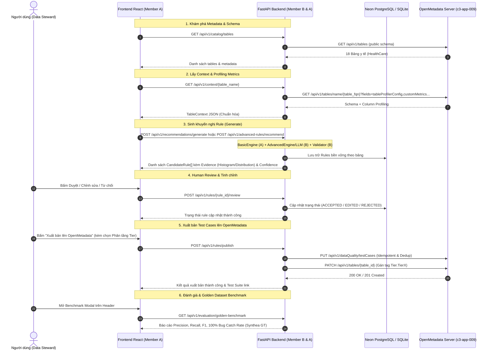

# TÀI LIỆU API CONTRACT DÀNH CHO FRONTEND - BACKEND
**Dự án:** Data Quality Rule Recommender & Observability Platform (Tích hợp OpenMetadata)  
**Phiên bản API:** `v1.0`  
**Base URL:** `http://localhost:8000/api/v1`  
**Định dạng dữ liệu:** `application/json; charset=utf-8`  
**CORS Policy:** Đã cấu hình cho phép Frontend (`http://localhost:5173` và `*`)

---

## 1. TỔNG QUAN KIẾN TRÚC & PHÂN CHIA TRÁCH NHIỆM

Hệ thống hoạt động theo mô hình tích hợp hai chiều giữa Web UI (Thành viên A) và Backend/OpenMetadata Engine (Thành viên B):



### Phân công trách nhiệm giữa 2 thành viên:
- **Thành viên A:** Toàn quyền `frontend/`, client gọi API `frontend/src/services/openmetadataService.js`, thuật toán `backend/engine/basic_engine.py` (Heuristics có Guardrails chống false positive và tính toán phân phối dữ liệu histogram), giao diện Human Review, Modal Golden Benchmark và báo cáo UI.
- **Thành viên B:** Quản trị kết nối cơ sở dữ liệu (Postgres/Neon), module xây dựng Context & Profiler (`backend/integrations/openmetadata_client.py`), động cơ sinh luật nâng cao LLM/SQL (`backend/engine/advanced_llm/`, `backend/engine/sql_mapper/`, `backend/api/router/routes_advanced_rules.py`), bộ lưu trữ bền vững (`backend/repository/recommendation_repository.py`), bộ thẩm định định lượng (`backend/evaluation/golden_evaluator.py`), và module đẩy Test Case Idempotent/Dedup (`backend/integrations/openmetadata_publisher.py`).

---

## 2. DANH SÁCH CHI TIẾT CÁC ENDPOINT API

### NHÓM 1: KIỂM TRA HỆ THỐNG & KẾT NỐI (SYSTEM & HEALTH)

#### 1.1 `GET /api/v1/health`
- **Mục đích:** FE gọi định kỳ khi khởi động hoặc render Header để xác định trạng thái Backend và kiểm tra xem Backend có ping được tới OpenMetadata Server hay không.
- **Request:** Không yêu cầu query params/body.
- **Response Success (200 OK):**
```json
{
  "status": "healthy",
  "openmetadata_connected": true,
  "openmetadata_url": "https://c3-app-009.duckdns.org/api/v1"
}
```
- **Response Khi Mất Kết Nối OpenMetadata (200 OK):**
```json
{
  "status": "healthy",
  "openmetadata_connected": false,
  "openmetadata_url": "https://c3-app-009.duckdns.org/api/v1"
}
```

---

### NHÓM 2: KHÁM PHÁ CATALOG METADATA (OPENMETADATA EXPLORER)

#### 2.1 `GET /api/v1/catalog/services`
- **Mục đích:** Lấy danh sách Database Services được tích hợp trên OpenMetadata.
- **Response (200 OK):**
```json
{
  "services": [
    {
      "id": "e4f8d212-0001-4c12-98ab-123456789abc",
      "name": "healthcare_postgres",
      "fullyQualifiedName": "healthcare_postgres",
      "serviceType": "Postgres",
      "description": "PostgreSQL database chứa 18 bảng dữ liệu bệnh nhân và y tế"
    }
  ]
}
```

#### 2.2 `GET /api/v1/catalog/databases`
- **Mục đích:** Lấy danh sách database thuộc service được chọn.
- **Query Params:**
  - `service` (string, optional, mặc định: `"healthcare_postgres"`)
- **Response (200 OK):**
```json
{
  "databases": [
    {
      "id": "a1b2c3d4-db01-4433-a123-bcde12345678",
      "name": "HealthCare",
      "fullyQualifiedName": "healthcare_postgres.HealthCare",
      "description": "Database hồ sơ bệnh án điện tử"
    }
  ]
}
```

#### 2.3 `GET /api/v1/catalog/schemas`
- **Mục đích:** Lấy danh sách schemas thuộc database.
- **Query Params:**
  - `databaseFqn` (string, optional, mặc định: `"healthcare_postgres.HealthCare"`)
- **Response (200 OK):**
```json
{
  "schemas": [
    {
      "id": "f5e4d3c2-sc01-4422-9988-aabbccddeeff",
      "name": "public",
      "fullyQualifiedName": "healthcare_postgres.HealthCare.public",
      "description": "Public schema chứa 18 bảng nghiệp vụ"
    }
  ]
}
```

#### 2.4 `GET /api/v1/catalog/tables`
- **Mục đích:** Lấy danh sách toàn bộ 18 bảng dữ liệu trong schema. FE dùng để đổ vào thanh điều hướng bên trái và thanh tìm kiếm.
- **Query Params:**
  - `schemaFqn` (string, optional, mặc định: `"healthcare_postgres.HealthCare.public"`)
  - `refresh` (boolean, optional, mặc định: `false`) - Khi truyền `true`, Backend sẽ bỏ qua cache 3 phút và quét mới từ OpenMetadata.
- **Response (200 OK):**
```json
{
  "tables": [
    {
      "id": "c2a099b0-44de-4a4a-a4f2-a21032041fa1",
      "name": "patients",
      "fullyQualifiedName": "healthcare_postgres.HealthCare.public.patients",
      "description": "Thông tin nhân khẩu học và thông tin cá nhân của bệnh nhân, bao gồm ngày sinh, ngày mất, SSN, họ tên, địa chỉ, chủng tộc, dân tộc, giới tính và dữ liệu tài chính y tế.",
      "tableType": "Regular",
      "version": 0.2
    },
    {
      "id": "1f86c362-14e3-49cb-a7c4-b6d832c6dc38",
      "name": "allergies",
      "fullyQualifiedName": "healthcare_postgres.HealthCare.public.allergies",
      "description": "Hồ sơ dị ứng của bệnh nhân, bao gồm tác nhân, loại phản ứng, mức độ nghiêm trọng và phân loại (dị ứng hoặc không dung nạp).",
      "tableType": "Regular",
      "version": 0.2
    }
  ]
}
```

#### 2.5 `GET /api/v1/catalog/tables/{table_id_or_name}`
- **Mục đích:** Lấy raw metadata thực tế của bảng từ OpenMetadata (gồm JSON schema, tags, owners, domains, profiling metrics).
- **Path Param:** `table_id_or_name` (string, bắt buộc) - UUID hoặc tên bảng (vd: `patients`).
- **Query Params:**
  - `refresh` (boolean, optional, mặc định: `false`) - Bỏ qua cache.
- **Response (200 OK):** Đối tượng Table Entity nguyên bản của OpenMetadata.

---

### NHÓM 3: ĐẶC TẢ BẢNG & ĐO LƯỜNG CHẤT LƯỢNG (TABLE CONTEXT & PROFILING)

#### 3.1 `GET /api/v1/tables`
- **Mục đích:** Endpoint rút gọn trả về danh sách bảng cho Quick Selector trên thanh Header / Toolbar.
- **Query Params:**
  - `refresh` (boolean, optional, mặc định: `false`) - Bỏ qua cache.
- **Response (200 OK):**
```json
{
  "tables": [
    {
      "id": "c2a099b0-44de-4a4a-a4f2-a21032041fa1",
      "name": "patients",
      "fullyQualifiedName": "healthcare_postgres.HealthCare.public.patients",
      "description": "Thông tin nhân khẩu học và thông tin cá nhân của bệnh nhân...",
      "version": 0.2
    }
  ]
}
```

#### 3.2 `GET /api/v1/context/{table_name}`
- **Mục đích:** Lấy đối tượng chuẩn hóa `TableContext` phục vụ render màn hình Schema, màn hình Profiling Metrics, và làm đầu vào cho Rule Recommendation Engine.
- **Path Param:** `table_name` (string, bắt buộc) - Tên bảng (vd: `patients`, `encounters`, `conditions`, ...).
- **Query Params:**
  - `refresh` (boolean, optional, mặc định: `false`) - Kích hoạt khi người dùng bấm nút **`Đồng bộ OM Live`** trên UI để ép buộc kéo dữ liệu mới nhất mà không chờ hết hạn cache 3 phút.
- **Response (200 OK - Model `TableContext`):**
```json
{
  "datasource_id": "openmetadata-live",
  "database_name": "HealthCare",
  "schema_name": "public",
  "table_name": "patients",
  "table_description": "Thông tin nhân khẩu học và thông tin cá nhân của bệnh nhân, bao gồm ngày sinh, ngày mất, SSN, họ tên, địa chỉ, chủng tộc, dân tộc, giới tính và dữ liệu tài chính y tế.",
  "row_count": 108,
  "version": 0.2,
  "tier": null,
  "domain": null,
  "owner": null,
  "tags": [],
  "columns": [
    {
      "name": "id",
      "data_type": "text",
      "nullable": false,
      "description": "Định danh duy nhất của bệnh nhân",
      "is_primary_key": true,
      "is_foreign_key": false,
      "profile": {
        "row_count": 108,
        "null_count": 0,
        "null_ratio": 0.0,
        "distinct_count": 108,
        "distinct_ratio": 1.0,
        "min_value": null,
        "max_value": null,
        "min_length": 36,
        "max_length": 36,
        "top_values": []
      }
    },
    {
      "name": "gender",
      "data_type": "text",
      "nullable": false,
      "description": "Giới tính của bệnh nhân",
      "is_primary_key": false,
      "is_foreign_key": false,
      "profile": {
        "row_count": 108,
        "null_count": 0,
        "null_ratio": 0.0,
        "distinct_count": 2,
        "distinct_ratio": 0.0185,
        "min_value": "F",
        "max_value": "M",
        "min_length": 1,
        "max_length": 1,
        "top_values": [
          {"value": "M", "count": 52, "percentage": 48.1},
          {"value": "F", "count": 56, "percentage": 51.9}
        ]
      }
    }
  ],
  "existing_rules": []
}
```

---

### NHÓM 4: SINH KHUYẾN NGHỊ VÀ QUẢN LÝ LUẬT (RECOMMENDATION ENGINE & PERSISTENCE)

#### 4.1 `POST /api/v1/recommendations/generate`
- **Mục đích:** Khi người dùng bấm nút **"Sinh khuyến nghị (Generate Rules)"** trên UI:
  1. Backend nạp `TableContext` từ OpenMetadata.
  2. Kích hoạt `BasicRuleEngine` (Thành viên A) sinh Heuristic rules có áp dụng Guardrails (loại trừ cột ngày tháng, ID, mô tả tự do).
  3. Kích hoạt `AdvancedRuleEngine` (Thành viên B) sinh Domain/Temporal/Cross-column rules nếu `engines` chứa `"ADVANCED"`.
  4. Tự động tính toán mảng `distribution` trong `evidence` (phục vụ biểu đồ Histogram trên UI).
  5. Tự động lưu bền vững toàn bộ CandidateRules theo `table_name` vào cơ sở dữ liệu (Neon PostgreSQL / SQLite).
  6. Trả về danh sách `CandidateRule[]` hiển thị lên thẻ RuleCard.
- **Request Body (JSON):**
```json
{
  "table_name": "patients",
  "datasource_id": "openmetadata",
  "engines": ["BASIC", "ADVANCED"]
}
```
| Tham số | Kiểu dữ liệu | Bắt buộc | Ý nghĩa |
| :--- | :--- | :--- | :--- |
| `table_name` | string | Có | Tên bảng cần sinh luật (vd: `patients`) |
| `datasource_id` | string | Không | Nguồn dữ liệu (mặc định: `"openmetadata"`) |
| `engines` | string[] | Không | Danh sách engine kích hoạt (`["BASIC"]`, `["ADVANCED"]`, hoặc cả hai) |

- **Response (200 OK):**
```json
{
  "table_name": "patients",
  "row_count": 108,
  "total_rules": 3,
  "rules": [
    {
      "id": "rule_a1b2c3d4",
      "table_name": "patients",
      "rule_type": "columnValuesToBeNotNull",
      "description": "Cột không được để trống (Not Null)",
      "target_columns": ["id"],
      "parameters": {},
      "expression": null,
      "engine": "BASIC",
      "confidence": 1.0,
      "reason": "Dữ liệu thực tế có 0/108 giá trị null (0.0%). Cột mang tính toàn vẹn cao.",
      "evidence": {
        "null_count": 0,
        "null_ratio": 0.0,
        "total_rows": 108
      },
      "validation_status": "VALID",
      "validation_message": null,
      "status": "DRAFT",
      "edited_parameters": null,
      "created_at": "2026-10-13T10:00:00Z"
    },
    {
      "id": "rule_e5f6g7h8",
      "table_name": "patients",
      "rule_type": "columnValuesToBeInSet",
      "description": "Giá trị thuộc danh mục cho phép (2 giá trị)",
      "target_columns": ["gender"],
      "parameters": {
        "allowedValues": ["F", "M"]
      },
      "expression": null,
      "engine": "BASIC",
      "confidence": 0.95,
      "reason": "Cột 'gender' có số lượng giá trị phân biệt thấp (2 giá trị), dữ liệu chỉ nằm trong tập chuẩn.",
      "evidence": {
        "distinct_count": 2,
        "cardinality_ratio": 0.0185,
        "observed_values": ["F", "M"],
        "allowed_values": ["F", "M"],
        "distribution": [
          {"label": "F", "count": 56, "percentage": 51.9},
          {"label": "M", "count": 52, "percentage": 48.1}
        ],
        "total_rows": 108,
        "sample_violations_count": 0
      },
      "validation_status": "VALID",
      "validation_message": null,
      "status": "DRAFT",
      "edited_parameters": null,
      "created_at": "2026-10-13T10:00:00Z"
    },
    {
      "id": "rule_adv_pat_001",
      "table_name": "patients",
      "rule_type": "tableCustomSQLQuery",
      "description": "Ràng buộc tử vong: Ngày mất (deathdate) phải sau ngày sinh (birthdate)",
      "target_columns": ["birthdate", "deathdate"],
      "parameters": {
        "sqlExpression": "deathdate IS NULL OR deathdate >= birthdate"
      },
      "expression": null,
      "engine": "ADVANCED",
      "confidence": 0.98,
      "reason": "Logic thời gian y tế: Thời điểm mất (deathdate) phải sau hoặc trùng với thời điểm sinh (birthdate).",
      "evidence": {
        "sample_violations_count": 0,
        "total_rows": 108
      },
      "validation_status": "VALID",
      "validation_message": null,
      "status": "DRAFT",
      "edited_parameters": null,
      "created_at": "2026-10-13T10:00:00Z"
    }
  ]
}
```

---

#### 4.2 `GET /api/v1/recommendations`
- **Mục đích:** Lấy danh sách các DQ rules đã lưu của một bảng từ Database (Neon PostgreSQL). Giúp giữ nguyên trạng thái khi người dùng chuyển qua lại giữa các bảng hoặc tải lại trang web.
- **Query Params:**
  - `table_name` (string, bắt buộc) - Tên bảng (vd: `patients`)
  - `status` (string, optional) - Lọc theo trạng thái (`DRAFT`, `ACCEPTED`, `EDITED`, `REJECTED`)
- **Response (200 OK):**
```json
{
  "table_name": "patients",
  "total_rules": 3,
  "rules": [ /* Danh sách CandidateRule[] */ ]
}
```

---

#### 4.3 `GET /api/v1/recommendations/tables`
- **Mục đích:** Lấy danh sách tất cả các bảng hiện đã có rules được lưu trữ trong Database. FE dùng để hiển thị biểu tượng/badge báo hiệu bảng nào đã được sinh rules.
- **Response (200 OK):**
```json
{
  "total_tables": 3,
  "tables": ["patients", "medications", "observations"]
}
```

---

#### 4.4 `DELETE /api/v1/recommendations`
- **Mục đích:** Xóa toàn bộ các DQ rules đã lưu của một bảng trong Database khi người dùng muốn reset và sinh lại từ đầu.
- **Query Params:**
  - `table_name` (string, bắt buộc)
- **Response (200 OK):**
```json
{
  "table_name": "patients",
  "deleted_count": 12,
  "message": "Đã xóa 12 rules của bảng patients"
}
```

---

#### 4.5 `POST /api/v1/advanced-rules/recommend`
- **Mục đích:** Pipeline sinh luật nâng cao chuyên sâu kết hợp LLM và SQL Mapper:
  1. Router nhận diện nhóm rule tiềm năng (Temporal, Cross-Column, Conditional Dependency).
  2. Generator sinh logic vị từ vi phạm (violation predicate).
  3. SQL Mapper dịch vị từ thành câu truy vấn SQL chuẩn hóa kiểm tra vi phạm.
  4. Tự động lưu candidate rules vào Review Service.
- **Request Body (JSON):**
```json
{
  "table_name": "patients",
  "table_description": "Thông tin nhân khẩu học và bệnh án",
  "min_confidence": 0.6,
  "columns": [
    {
      "name": "birthdate",
      "data_type": "date",
      "nullable": false,
      "description": "Ngày sinh bệnh nhân"
    },
    {
      "name": "deathdate",
      "data_type": "date",
      "nullable": true,
      "description": "Ngày mất bệnh nhân"
    }
  ]
}
```
- **Response (200 OK):**
```json
{
  "table_name": "patients",
  "candidates": [
    {
      "rule_type": "TEMPORAL_ORDER",
      "columns": ["birthdate", "deathdate"],
      "confidence": 0.95
    }
  ],
  "rules": [
    {
      "rule_type": "TEMPORAL_ORDER",
      "table": "patients",
      "columns": ["birthdate", "deathdate"],
      "conditions": [
        {"field": "deathdate", "op": "gte", "value": "birthdate"}
      ],
      "confidence": 0.95,
      "reason": "Ngày mất phải lớn hơn hoặc bằng ngày sinh",
      "sql": "SELECT * FROM patients WHERE deathdate < birthdate",
      "violation_predicate": "deathdate < birthdate",
      "params": {},
      "sql_error": null
    }
  ],
  "total_candidates": 1,
  "total_rules_generated": 1,
  "total_sql_mapped": 1,
  "total_sql_failed": 0,
  "errors": []
}
```

---

### NHÓM 5: QUY TRÌNH DUYỆT HUMAN REVIEW

#### 5.1 `POST /api/v1/rules/{rule_id}/review`
- **Mục đích:** Xử lý tương tác duyệt của Data Steward trên thẻ Rule Card:
  - Bấm **"Chấp thuận (Accept)"** $\rightarrow$ `action: "ACCEPTED"`.
  - Bấm **"Từ chối (Reject)"** $\rightarrow$ `action: "REJECTED"`.
  - Bấm **"Chỉnh sửa (Edit)"** $\rightarrow$ `action: "EDITED"` kèm `edited_parameters`.
- **Path Param:** `rule_id` (string, bắt buộc) - ID của luật.
- **Request Body (JSON):**
```json
{
  "action": "EDITED",
  "edited_parameters": {
    "minValue": 0,
    "maxValue": 120
  },
  "comment": "Điều chỉnh biên tuổi phù hợp với nghiên cứu lâm sàng"
}
```
| Trường | Kiểu dữ liệu | Giá trị hợp lệ | Ý nghĩa |
| :--- | :--- | :--- | :--- |
| `action` | string | `"ACCEPTED"`, `"REJECTED"`, `"EDITED"` | Quyết định duyệt |
| `edited_parameters` | object | null hoặc object dict | Tham số sau chỉnh sửa |
| `comment` | string | null hoặc string | Ghi chú lý do của Data Steward |

- **Response Success (200 OK):**
```json
{
  "message": "Đã cập nhật rule rule_a1b2c3d4 thành EDITED",
  "rule": {
    "id": "rule_a1b2c3d4",
    "rule_type": "columnValuesToBeBetween",
    "status": "EDITED",
    "edited_parameters": {
      "minValue": 0,
      "maxValue": 120
    }
  }
}
```

---

### NHÓM 6: XUẤT BẢN TEST CASES LÊN OPENMETADATA (PUBLISH TEST CASES & CLEANUP)

#### 6.1 `POST /api/v1/rules/publish`
- **Mục đích:** Đẩy toàn bộ các rule đã được phê duyệt (`ACCEPTED` hoặc `EDITED`) lên máy chủ OpenMetadata Live, đồng thời tự động cập nhật phân tầng Tier của bảng nếu được chỉ định.
- **Backend xử lý (Trách nhiệm Thành viên B):**
  - Tự động tìm hoặc khởi tạo `TestSuite` tương ứng với bảng.
  - Sử dụng phương thức **`PUT /api/v1/dataQuality/testCases`** đảm bảo tính **Idempotent** (ghi đè an toàn, không bị lỗi `409 Conflict`).
  - Áp dụng cơ chế **Deduplicate**: kiểm tra trùng lặp với các test cases đang có sẵn trên OpenMetadata để cập nhật tham số thay vì tạo thừa bản ghi.
  - Nếu `tier` được truyền (vd: `"Tier1"`), backend tự động gọi RFC 6902 JSON Patch cập nhật tag `Tier.<Tier>` trên OpenMetadata Live.
- **Request Body (JSON):**
```json
{
  "table_name": "patients",
  "tier": "Tier1",
  "rule_ids": ["rule_a1b2c3d4", "rule_adv_pat_001"],
  "rules": [
    {
      "id": "rule_a1b2c3d4",
      "rule_type": "columnValuesToBeNotNull",
      "description": "Cột không được để trống (Not Null)",
      "target_columns": ["id"],
      "parameters": {},
      "engine": "BASIC",
      "status": "ACCEPTED"
    }
  ]
}
```
> *Lưu ý: FE hỗ trợ gửi danh sách `rules` đầy đủ hoặc chỉ mảng `rule_ids`. Nếu để trống cả 2, Backend tự động lấy toàn bộ các rule có trạng thái `ACCEPTED` hoặc `EDITED` trong database của bảng đó.*

- **Response Success (200 OK):**
```json
{
  "success": true,
  "message": "Đã xuất bản thành công 4 test cases lên OpenMetadata!",
  "published_count": 4,
  "test_suite_id": "a9e102f4-7128-40ea-9bb2-123456789abc",
  "tier_updated": true,
  "tier": "Tier.Tier1",
  "published_test_cases": [
    {
      "rule_id": "rule_a1b2c3d4",
      "test_case_name": "patients_id_columnValuesToBeNotNull",
      "test_definition": "columnValuesToBeNotNull",
      "column_name": "id",
      "status": "PUBLISHED",
      "openmetadata_id": "8fa12345-0001-4444-aaaa-bbbbccccdddd"
    },
    {
      "rule_id": "rule_adv_pat_001",
      "test_case_name": "patients_tableCustomSQLQuery",
      "test_definition": "tableCustomSQLQuery",
      "column_name": null,
      "status": "PUBLISHED",
      "openmetadata_id": "8fa12345-0002-4444-aaaa-bbbbccccdddd"
    }
  ],
  "failed_rules": []
}
```

---

#### 6.2 `POST /api/v1/rules/cleanup-duplicates`
- **Mục đích:** Quét toàn bộ Test Cases của bảng trên OpenMetadata, phát hiện các test case bị trùng mục đích kiểm thử (cùng testDefinition + cùng column hoặc trùng SQL test), giữ lại bản ghi mới nhất và dọn dẹp các bản ghi dư thừa.
- **Request Body (JSON):**
```json
{
  "table_name": "patients"
}
```
- **Response Success (200 OK):**
```json
{
  "success": true,
  "table_name": "patients",
  "scanned_count": 15,
  "deleted_count": 3,
  "kept_count": 12,
  "deleted_test_cases": [
    "patients_id_columnValuesToBeNotNull_old",
    "patients_gender_columnValuesToBeInSet_dup"
  ]
}
```

---

#### 6.3 `PUT /api/v1/tables/{table_name}/tier`
- **Mục đích:** Cập nhật hoặc gỡ bỏ phân tầng dữ liệu (Tier 1-5 hoặc null) trực tiếp lên máy chủ OpenMetadata Live.
- **Backend xử lý:** Gọi RFC 6902 JSON Patch (`PATCH /api/v1/tables/{table_id}`) với tag `Tier.Tier1` ... `Tier.Tier5` trong mảng `/tags`. Nếu gửi `{"tier": null}` thì gỡ bỏ tag phân tầng.
- **Request Body (JSON):**
```json
{
  "tier": "Tier1"
}
```
- **Response Success (200 OK):**
```json
{
  "success": true,
  "table_name": "patients",
  "tier": "Tier1",
  "message": "Đã cập nhật phân tầng dữ liệu thành Tier1 trên OpenMetadata"
}
```

---

### NHÓM 7: BÁO CÁO ĐÁNH GIÁ CHẤT LƯỢNG & BENCHMARK (EVALUATION & GOLDEN BENCHMARK)

#### 7.1 `GET /api/v1/evaluation/summary`
- **Mục đích:** FE hiển thị Dashboard Đánh giá & Kiểm nghiệm kỹ thuật chứng minh độ bao phủ (Coverage) và độ an toàn (Safety) trên toàn bộ 18 bảng dataset y tế.
- **Response (200 OK):**
```json
{
  "dataset": "HealthCare (OpenMetadata Live)",
  "service_fqn": "healthcare_postgres.HealthCare.public",
  "evaluated_tables_count": 18,
  "total_columns_evaluated": 258,
  "total_rules_generated": 544,
  "overall_column_coverage_pct": 95.35,
  "average_rules_per_table": 30.2,
  "rule_type_distribution": {
    "tableRowCountToBeBetween": 18,
    "columnValuesToBeNotNull": 193,
    "columnValuesToBeBetween": 86,
    "columnValuesToBeInSet": 95,
    "columnValuesLengthToBeBetween": 110,
    "columnValuesToBeUnique": 42
  },
  "safety_metrics": {
    "invalid_column_rate": 0.0,
    "duplicate_candidate_rate": 0.0,
    "type_validation_failure_rate": 0.0,
    "all_safety_passed": true
  },
  "performance": {
    "total_time_ms": 64495.62,
    "avg_latency_per_table_ms": 3583.09
  },
  "tables_detail": [
    {
      "table_name": "patients",
      "row_count": 108,
      "column_count": 28,
      "covered_columns_count": 28,
      "column_coverage_pct": 100.0,
      "total_rules": 70,
      "safety": {
        "invalid_columns_count": 0,
        "duplicates_count": 0,
        "type_failures_count": 0,
        "is_safety_pass": true
      },
      "latency_ms": 5805.89
    }
  ]
}
```

---

#### 7.2 `GET /api/v1/evaluation/golden-benchmark`
- **Mục đích:** Chạy bộ kiểm thử định lượng Golden Dataset Benchmark đối chiếu với đặc tả Synthea Data Dictionary (Ground Truth Specification) và bộ dữ liệu kiểm thử (Clean baseline records + Injected Defect records) trên 3 bảng cốt lõi: `patients`, `medications`, `observations`.
- **Query Params:**
  - `force_refresh` (boolean, optional, mặc định: `false`) - Bắt buộc chạy lại đánh giá mà không dùng kết quả bộ nhớ đệm cache.
- **Tính toán:**
  - **Precision & Recall:** So khớp các rule sinh ra với danh mục Ground Truth Rules mong đợi.
  - **Defect Detection Rate (Bug Catch Rate):** Tỉ lệ phát hiện chính xác các bản ghi bị cấy lỗi có chủ đích (lỗi ngày tháng, giá trị âm, trùng khóa chính...). Hệ thống đạt **100.0%**.
  - **Clean Pass Rate:** Tỉ lệ các bản ghi dữ liệu sạch vượt qua toàn bộ các rule (không sinh cảnh báo giả). Hệ thống đạt **100.0%**.
- **Response Success (200 OK):**
```json
{
  "benchmark_name": "Synthea Healthcare Golden Dataset Evaluation",
  "evaluated_tables": [
    "patients",
    "medications",
    "observations"
  ],
  "overall_summary": {
    "total_rules_generated": 68,
    "total_ground_truth_rules": 31,
    "average_precision": 48.65,
    "average_recall": 93.33,
    "average_f1_score": 63.85,
    "overall_defect_detection_rate": 100.0,
    "clean_data_pass_rate": 100.0,
    "status": "EXCELLENT"
  },
  "tables": [
    {
      "table_name": "patients",
      "total_columns": 25,
      "ground_truth_rules_count": 11,
      "metrics": {
        "true_positives": 10,
        "precision": 41.67,
        "recall": 90.91,
        "f1_score": 57.14
      },
      "missing_golden_rules": [
        {
          "rule_type": "columnValuesToBeBetween",
          "target_columns": ["healthcare_expenses"],
          "category": "NUMERIC_RANGE",
          "reason": "Chi phí y tế tích lũy phải nằm trong dải [0 .. 2000000]"
        }
      ],
      "defect_testing": {
        "total_test_records": 32,
        "clean_records_count": 25,
        "clean_pass_rate": 100.0,
        "defect_records_count": 7,
        "caught_defects_count": 7,
        "defect_detection_rate": 100.0,
        "scenarios": [
          {
            "fault": "INVALID_TEMPORAL_ORDER (deathdate < birthdate)",
            "is_detected": true,
            "detected_by": ["tableCustomSQLQuery:birthdate,deathdate"]
          },
          {
            "fault": "OUT_OF_BOUNDS_NUMERIC (healthcare_expenses < 0)",
            "is_detected": true,
            "detected_by": ["columnValuesToBeBetween:healthcare_expenses"]
          },
          {
            "fault": "DUPLICATE_PRIMARY_KEY (id duplicate)",
            "is_detected": true,
            "detected_by": ["columnValuesToBeUnique:id"]
          }
        ]
      }
    },
    {
      "table_name": "medications",
      "total_columns": 13,
      "ground_truth_rules_count": 10,
      "metrics": {
        "true_positives": 10,
        "precision": 52.63,
        "recall": 100.0,
        "f1_score": 68.97
      },
      "missing_golden_rules": [],
      "defect_testing": {
        "total_test_records": 19,
        "clean_records_count": 12,
        "clean_pass_rate": 100.0,
        "defect_records_count": 7,
        "caught_defects_count": 7,
        "defect_detection_rate": 100.0,
        "scenarios": [
          {
            "fault": "NEGATIVE_COST (base_cost < 0)",
            "is_detected": true,
            "detected_by": ["columnValuesToBeBetween:base_cost"]
          }
        ]
      }
    },
    {
      "table_name": "observations",
      "total_columns": 10,
      "ground_truth_rules_count": 10,
      "metrics": {
        "true_positives": 9,
        "precision": 51.67,
        "recall": 90.0,
        "f1_score": 65.45
      },
      "missing_golden_rules": [],
      "defect_testing": {
        "total_test_records": 21,
        "clean_records_count": 13,
        "clean_pass_rate": 100.0,
        "defect_records_count": 8,
        "caught_defects_count": 8,
        "defect_detection_rate": 100.0,
        "scenarios": [
          {
            "fault": "INVALID_OBSERVATION_DATE (date in future)",
            "is_detected": true,
            "detected_by": ["columnValuesToBeBetween:date"]
          }
        ]
      }
    }
  ]
}
```

---

## 3. CÁC SCHEMA DỮ LIỆU CỐT LÕI (DATA CONTRACTS)

Cả hai thành viên tuân thủ nghiêm ngặt các cấu trúc Pydantic sau (tại `backend/contracts/`):

### 3.1 `CandidateRule` (`backend/contracts/candidate_rule.py`)
```python
class CandidateRule(BaseModel):
    id: str                                  # Định danh unique của rule (vd: rule_a1b2c3d4)
    table_name: Optional[str] = None         # Tên bảng áp dụng (vd: patients)
    rule_type: str                           # Tên loại test OpenMetadata
    description: Optional[str] = None        # Mô tả tiếng Việt thân thiện với người dùng
    target_columns: List[str]                # Danh sách cột áp dụng
    parameters: Dict[str, Any] = {}          # Tham số test: minValue, maxValue, allowedValues, sqlExpression...
    expression: Optional[str] = None         # Biểu thức SQL (nếu có)
    engine: Literal["BASIC", "ADVANCED"]     # Nguồn sinh: "BASIC" (Thành viên A) hoặc "ADVANCED" (Thành viên B)
    confidence: float = 1.0                  # Độ tin cậy từ 0.0 đến 1.0
    reason: str                              # Giải thích nghiệp vụ bằng tiếng Việt
    evidence: Dict[str, Any] = {}            # Bằng chứng định lượng (null_count, distinct_count, distribution...)
    validation_status: Literal["VALID", "WARNING", "INVALID"] = "VALID"
    validation_message: Optional[str] = None # Thông báo cảnh báo của Validator
    status: Literal["DRAFT", "ACCEPTED", "EDITED", "REJECTED"] = "DRAFT"
    edited_parameters: Optional[Dict[str, Any]] = None # Tham số sau khi Data Steward chỉnh sửa
    created_at: str                          # ISO 8601 Timestamp
```

#### Cấu trúc trường `evidence` phục vụ biểu đồ Histogram (`RuleHistogramChart.jsx`):
- Đối với rule `columnValuesToBeInSet`:
  ```json
  "evidence": {
    "distinct_count": 2,
    "cardinality_ratio": 0.0185,
    "observed_values": ["F", "M"],
    "allowed_values": ["F", "M"],
    "distribution": [
      {"label": "F", "count": 56, "percentage": 51.9},
      {"label": "M", "count": 52, "percentage": 48.1}
    ],
    "total_rows": 108,
    "sample_violations_count": 0
  }
  ```
- Đối với rule `columnValuesToBeBetween`:
  ```json
  "evidence": {
    "min_observed": 0.0,
    "max_observed": 100.0,
    "expected_range": [0.0, 100.0],
    "distribution": [
      {"label": "0 - 25", "count": 25, "percentage": 25.0},
      {"label": "25 - 50", "count": 30, "percentage": 30.0},
      {"label": "50 - 75", "count": 25, "percentage": 25.0},
      {"label": "75 - 100", "count": 20, "percentage": 20.0}
    ],
    "total_rows": 108,
    "sample_violations_count": 0
  }
  ```

---

### 3.2 `TableContext` (`backend/contracts/table_context.py`)
```python
class ColumnProfile(BaseModel):
    row_count: int = 0
    null_count: int = 0
    null_ratio: float = 0.0
    distinct_count: int = 0
    distinct_ratio: float = 0.0
    min_value: Optional[Any] = None
    max_value: Optional[Any] = None
    min_length: Optional[int] = None
    max_length: Optional[int] = None
    top_values: List[Dict[str, Any]] = []

class ColumnContext(BaseModel):
    name: str
    data_type: str
    nullable: bool = True
    description: Optional[str] = None
    is_primary_key: bool = False
    is_foreign_key: bool = False
    profile: ColumnProfile = ColumnProfile()

class TableContext(BaseModel):
    datasource_id: str = "openmetadata-live"
    database_name: str
    schema_name: str
    table_name: str
    table_description: Optional[str] = None
    row_count: int = 0
    version: Optional[float] = None          # Phiên bản thực tế từ OpenMetadata (vd: 0.2)
    tier: Optional[str] = None               # None nếu OpenMetadata chưa gán Tier
    domain: Optional[Any] = None             # None nếu OpenMetadata chưa gán Domain
    owner: Optional[Dict[str, Any]] = None   # None nếu OpenMetadata chưa chỉ định Owner
    tags: List[Dict[str, Any]] = []
    columns: List[ColumnContext] = []
    existing_rules: List[Dict[str, Any]] = []
```

---

### 3.3 Hợp đồng Advanced Rules với SQL (`RuleWithSQL`)
```python
class RuleWithSQL(BaseModel):
    rule_type: str
    table: str
    columns: List[str] = []
    conditions: List[dict] = []
    confidence: float
    reason: str = ""
    sql: str = ""                             # Query kiểm tra vi phạm SQL
    violation_predicate: str = ""             # Biểu thức vi phạm
    params: dict = {}
    sql_error: Optional[str] = None
```

---

## 4. BẢNG ÁNH XẠ RULE TYPE VỚI OPENMETADATA TEST DEFINITION

Khi viết module xuất bản (`openmetadata_publisher.py`) hoặc sinh luật nâng cao (`advanced_engine.py`), các `rule_type` map chính xác với Test Definition có sẵn trong OpenMetadata:

| Rule Type | Cấp độ (Scope) | Ý nghĩa nghiệp vụ | Tham số trong `parameters` |
| :--- | :--- | :--- | :--- |
| `columnValuesToBeNotNull` | Cột (Column) | Cột bắt buộc không được rỗng / null | Không cần tham số `{}` |
| `columnValuesToBeUnique` | Cột (Column) | Giá trị mỗi dòng phải duy nhất (Primary/Unique Key) | Không cần tham số `{}` |
| `columnValuesToBeBetween` | Cột (Column) | Ràng buộc dải số hoặc ngày hợp lệ | `{"minValue": x, "maxValue": y}` |
| `columnValuesToBeInSet` | Cột (Column) | Giá trị phải nằm trong tập danh mục cho phép | `{"allowedValues": ["A", "B"]}` |
| `columnValueLengthsToBeBetween` | Cột (Column) | Chiều dài chuỗi ký tự hợp lệ (UUID, SSN, Zip...) | `{"minLength": x, "maxLength": y}` |
| `tableRowCountToBeBetween` | Bảng (Table) | Số lượng bản ghi bảng trong khoảng an toàn | `{"minValue": x, "maxValue": y}` |
| `tableCustomSQLQuery` | Bảng (Table) | Logic chéo cột / Logic miền thời gian / Phụ thuộc điều kiện | `{"sqlExpression": "..."}` |

---

## 5. CHECKLIST PHỐI HỢP DÀNH CHO THÀNH VIÊN B

1. **Khởi chạy Backend:**
   ```bash
   # Chạy FastAPI Backend tại port 8000
   python -m uvicorn backend.main:app --host 127.0.0.1 --port 8000 --reload
   ```
2. **Khởi chạy Frontend Web:**
   ```bash
   # Chạy React UI tại port 5173
   npm run dev
   ```
3. **Cấu hình OpenMetadata Client & Database:**
   - Server OpenMetadata: `https://c3-app-009.duckdns.org/api/v1`
   - Đảm bảo token JWT còn hiệu lực trong file `.env` hoặc `backend/config/settings.py`.
   - Kết nối cơ sở dữ liệu lưu trữ rules bền vững (Neon PostgreSQL hoặc SQLite).
4. **Kiểm thử tự động Golden Benchmark & Deduplicate:**
   ```bash
   # Chạy pytest kiểm tra bộ đánh giá Golden Dataset Benchmark
   pytest tests/test_golden_evaluation.py -v
   ```
5. **Idempotency & Cleanliness khi Publish:**
   - Luôn sử dụng `PUT /api/v1/dataQuality/testCases` kết hợp cơ chế Deduplicate để không sinh test case rác hoặc lỗi `409 Conflict`.
   - Hỗ trợ gọi `POST /api/v1/rules/cleanup-duplicates` để tự động dọn sạch các test case trùng lặp trên OpenMetadata.

---

## 6. MÃ NGUỒN CLIENT PHÍA FRONTEND (`frontend/src/services/openmetadataService.js`)

Toàn bộ các cuộc gọi API từ phía Frontend được đóng gói tập trung tại `frontend/src/services/openmetadataService.js`:

```javascript
const API_BASE = 'http://localhost:8000/api/v1';

export const openmetadataService = {
  // 1. Kiểm tra trạng thái kết nối Backend & OpenMetadata Live
  async checkHealth() {
    try {
      const res = await fetch(`${API_BASE}/health`);
      if (res.ok) return await res.json();
    } catch (err) {
      console.warn('Lỗi kết nối Backend Health:', err);
    }
    return { status: 'offline', openmetadata_connected: false };
  },

  // 2. Lấy danh sách Services
  async getServices() {
    try {
      const res = await fetch(`${API_BASE}/catalog/services`);
      if (res.ok) {
        const data = await res.json();
        return data.services || [];
      }
    } catch (err) {
      console.warn('Lỗi lấy Services:', err);
    }
    return [{ name: 'healthcare_postgres', fullyQualifiedName: 'healthcare_postgres', serviceType: 'Postgres' }];
  },

  // 3. Lấy danh sách Databases
  async getDatabases(service = 'healthcare_postgres') {
    try {
      const res = await fetch(`${API_BASE}/catalog/databases?service=${encodeURIComponent(service)}`);
      if (res.ok) {
        const data = await res.json();
        return data.databases || [];
      }
    } catch (err) {
      console.warn('Lỗi lấy Databases:', err);
    }
    return [{ name: 'HealthCare', fullyQualifiedName: 'healthcare_postgres.HealthCare' }];
  },

  // 4. Lấy danh sách Schemas
  async getSchemas(databaseFqn = 'healthcare_postgres.HealthCare') {
    try {
      const res = await fetch(`${API_BASE}/catalog/schemas?databaseFqn=${encodeURIComponent(databaseFqn)}`);
      if (res.ok) {
        const data = await res.json();
        return data.schemas || [];
      }
    } catch (err) {
      console.warn('Lỗi lấy Schemas:', err);
    }
    return [{ name: 'public', fullyQualifiedName: 'healthcare_postgres.HealthCare.public' }];
  },

  // 5. Lấy danh sách 18 Tables (hỗ trợ refresh=true để bỏ qua cache 3 phút)
  async getTables(schemaFqn = 'healthcare_postgres.HealthCare.public', refresh = false) {
    try {
      const res = await fetch(`${API_BASE}/catalog/tables?schemaFqn=${encodeURIComponent(schemaFqn)}${refresh ? '&refresh=true' : ''}`);
      if (res.ok) {
        const data = await res.json();
        return data.tables || [];
      }
    } catch (err) {
      console.warn('Lỗi lấy danh sách Tables từ OpenMetadata:', err);
    }
    return [];
  },

  // 6. Lấy Raw Table Detail từ OpenMetadata
  async getTableDetail(tableIdOrName, refresh = false) {
    try {
      const res = await fetch(`${API_BASE}/catalog/tables/${encodeURIComponent(tableIdOrName)}${refresh ? '?refresh=true' : ''}`);
      if (res.ok) return await res.json();
    } catch (err) {
      console.warn(`Lỗi lấy chi tiết bảng ${tableIdOrName}:`, err);
    }
    return null;
  },

  // 7. Lấy TableContext chuẩn hóa (hỗ trợ refresh=true khi bấm "Đồng bộ OM Live")
  async getTableContext(tableName, refresh = false) {
    try {
      const res = await fetch(`${API_BASE}/context/${encodeURIComponent(tableName)}${refresh ? '?refresh=true' : ''}`);
      if (res.ok) return await res.json();
    } catch (err) {
      console.warn(`Lỗi lấy TableContext cho bảng ${tableName}:`, err);
    }
    return null;
  },

  // 8. Sinh Candidate Rules bằng BasicRuleEngine & Advanced Rules
  async generateRules(tableName, engines = ['BASIC', 'ADVANCED']) {
    try {
      const res = await fetch(`${API_BASE}/recommendations/generate`, {
        method: 'POST',
        headers: { 'Content-Type': 'application/json' },
        body: JSON.stringify({ table_name: tableName, engines: engines })
      });
      if (res.ok) return await res.json();
    } catch (err) {
      console.warn(`Lỗi sinh candidate rules cho bảng ${tableName}:`, err);
    }
    return null;
  },

  // 9. Lấy danh sách DQ rules đã lưu của một bảng từ Neon PostgreSQL
  async getSavedRules(tableName, status = null) {
    try {
      let url = `${API_BASE}/recommendations?table_name=${encodeURIComponent(tableName)}`;
      if (status) url += `&status=${encodeURIComponent(status)}`;
      const res = await fetch(url);
      if (res.ok) return await res.json();
    } catch (err) {
      console.warn(`Lỗi lấy rules đã lưu cho bảng ${tableName}:`, err);
    }
    return null;
  },

  // 10. Lấy danh sách các bảng đã có rules lưu trong Database
  async getTablesWithRules() {
    try {
      const res = await fetch(`${API_BASE}/recommendations/tables`);
      if (res.ok) return await res.json();
    } catch (err) {
      console.warn('Lỗi lấy danh sách bảng có rules:', err);
    }
    return { total_tables: 0, tables: [] };
  },

  // 11. Xóa toàn bộ rules đã lưu của một bảng trong Database
  async clearSavedRules(tableName) {
    try {
      const res = await fetch(`${API_BASE}/recommendations?table_name=${encodeURIComponent(tableName)}`, {
        method: 'DELETE'
      });
      if (res.ok) return await res.json();
    } catch (err) {
      console.warn(`Lỗi xóa rules đã lưu của bảng ${tableName}:`, err);
    }
    return null;
  },

  // 12. Sinh Advanced Rules (LLM) với SQL violation queries
  async generateAdvancedRules(tableName, columns, minConfidence = 0.6) {
    try {
      const res = await fetch(`${API_BASE}/advanced-rules/recommend`, {
        method: 'POST',
        headers: { 'Content-Type': 'application/json' },
        body: JSON.stringify({
          table_name: tableName,
          columns: columns,
          min_confidence: minConfidence
        })
      });
      if (res.ok) return await res.json();
    } catch (err) {
      console.warn(`Lỗi kết nối sinh Advanced Rules cho bảng ${tableName}:`, err);
    }
    return null;
  },

  // 13. Review hành động (Accept, Reject, Edit)
  async reviewRule(ruleId, action, editedParameters = null) {
    try {
      const res = await fetch(`${API_BASE}/rules/${ruleId}/review`, {
        method: 'POST',
        headers: { 'Content-Type': 'application/json' },
        body: JSON.stringify({ action: action, edited_parameters: editedParameters })
      });
      if (res.ok) return await res.json();
    } catch (err) {
      console.warn(`Lỗi gửi review cho rule ${ruleId}:`, err);
    }
    return null;
  },

  // 14. Cập nhật phân tầng Tier (Tier 1-5 hoặc null) của bảng lên OpenMetadata
  async updateTableTier(tableName, tier) {
    try {
      const res = await fetch(`${API_BASE}/tables/${encodeURIComponent(tableName)}/tier`, {
        method: 'PUT',
        headers: { 'Content-Type': 'application/json' },
        body: JSON.stringify({ tier: tier })
      });
      if (res.ok) return await res.json();
    } catch (err) {
      console.warn(`Lỗi cập nhật tier cho bảng ${tableName}:`, err);
    }
    return { success: false, message: 'Lỗi kết nối khi cập nhật Tier' };
  },

  // 15. Xuất bản các Rule đã duyệt lên OpenMetadata Test Cases & đồng bộ Tier
  async publishRules(tableName, rulesOrIds = null, tier = null) {
    try {
      const payload = { table_name: tableName };
      if (tier) payload.tier = tier;
      if (Array.isArray(rulesOrIds)) {
        if (rulesOrIds.length > 0 && typeof rulesOrIds[0] === 'object') {
          payload.rules = rulesOrIds;
        } else {
          payload.rule_ids = rulesOrIds;
        }
      }
      const res = await fetch(`${API_BASE}/rules/publish`, {
        method: 'POST',
        headers: { 'Content-Type': 'application/json' },
        body: JSON.stringify(payload)
      });
      if (res.ok) return await res.json();
    } catch (err) {
      console.warn(`Lỗi xuất bản rules lên OpenMetadata cho bảng ${tableName}:`, err);
    }
    return { success: false, message: 'Lỗi kết nối tới máy chủ OpenMetadata' };
  },

  // 16. Dọn dẹp test case bị trùng lặp trên OpenMetadata
  async cleanupDuplicateRules(tableName) {
    try {
      const res = await fetch(`${API_BASE}/rules/cleanup-duplicates`, {
        method: 'POST',
        headers: { 'Content-Type': 'application/json' },
        body: JSON.stringify({ table_name: tableName })
      });
      if (res.ok) return await res.json();
    } catch (err) {
      console.warn(`Lỗi dọn dẹp duplicate test cases cho bảng ${tableName}:`, err);
    }
    return { success: false, message: 'Lỗi dọn dẹp test cases trùng lặp' };
  },

  // 17. Lấy báo cáo Benchmark Evaluation định lượng (18 bảng)
  async getEvaluationSummary() {
    try {
      const res = await fetch(`${API_BASE}/evaluation/summary`);
      if (res.ok) return await res.json();
    } catch (err) {
      console.warn('Lỗi lấy báo cáo Evaluation:', err);
    }
    return null;
  },

  // 18. Lấy báo cáo Golden Benchmark Synthea đối chiếu Ground Truth (Precision, Recall, F1, Bug Catch Rate)
  async getGoldenEvaluationSummary(forceRefresh = false) {
    try {
      const url = `${API_BASE}/evaluation/golden-benchmark${forceRefresh ? '?force_refresh=true' : ''}`;
      const res = await fetch(url);
      if (res.ok) return await res.json();
    } catch (err) {
      console.warn('Lỗi lấy báo cáo Golden Benchmark:', err);
    }
    return null;
  }
};
```
