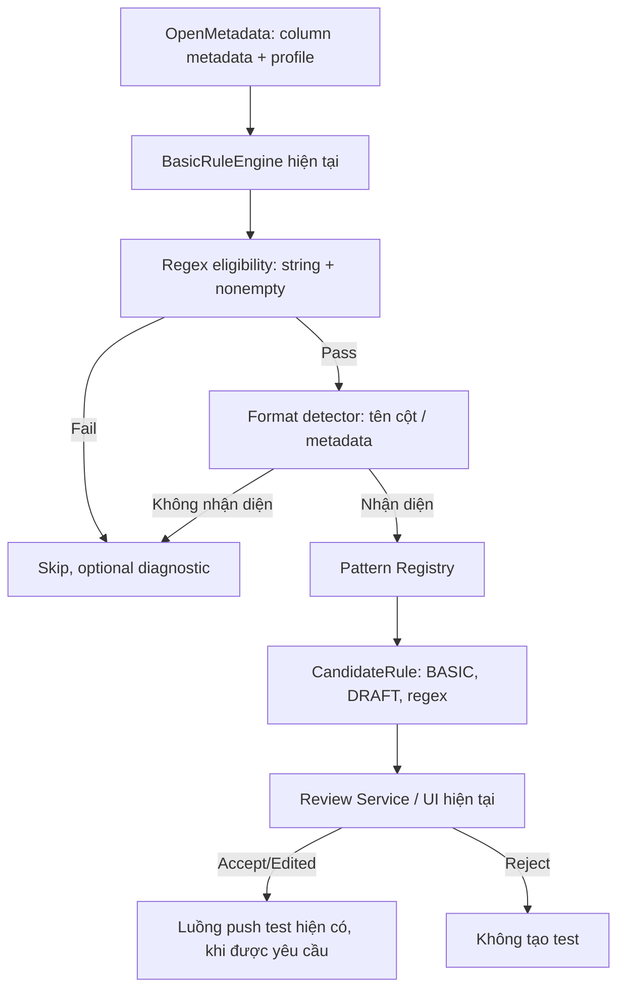

i# Implementation Plan — Basic Regex Rule Recommendation (Email, URL, First Name Case)

**Version:** 1.0 · **Date:** 2026-10-13  
**Project:** DQ Rule Recommender / OpenMetadata 2.0.x  
**Goal:** Bổ sung `columnValuesToMatchRegex` thành **Basic Rule thứ 6** bằng heuristic, không dùng LLM.  
**Status:** Hướng dẫn triển khai để Codex đọc code hiện tại, sửa tối thiểu và viết test.

> **Yêu cầu cao nhất cho Codex:** Trước khi code, kiểm tra lại đường đi thực tế của `BasicRuleEngine` → `CandidateRule` → review service → OpenMetadata. Tái sử dụng các mô hình và luồng đang có; **không dựng engine, router, LLM agent hoặc trang UI mới**. Kế hoạch này định nghĩa hành vi, **không ép đường dẫn file**. Nếu mã trên branch hiện tại khác mô tả, giữ ưu tiên cho API/contract hiện hành.

---

## 1. Phạm vi và quyết định thiết kế

### 1.1. Có trong phiên bản này

| Format ID | Cột có thể nhận diện | Quy tắc | Cơ chế |
|---|---|---|---|
| `EMAIL` | `email`, `email_address` | Email có cú pháp thông dụng | `columnValuesToMatchRegex` |
| `URL_HTTP` | `url`, `website`, `website_url` | URL bắt đầu bằng HTTP/HTTPS và có tên miền phổ biến | `columnValuesToMatchRegex` |
| `FIRST_NAME_CAPITALIZED` | **`first_name`** (không yêu cầu mô tả nghiệp vụ bổ sung) | Ký tự đầu viết hoa, các chữ còn lại viết thường | `columnValuesToMatchRegex` |

**Quyết định quan trọng cho `first_name`:**
- **Cứ sinh candidate** khi cột `first_name` thỏa điều kiện kỹ thuật, kể cả khi description không xác nhận Title Case.
- **Chỉ sinh một Regex** kiểm tra *uppercase chữ cái đầu + lowercase phần còn lại*. **Không sinh hai rule riêng `UPPERCASE` và `LOWERCASE`** vì hai điều kiện đó mâu thuẫn nếu áp trên toàn chuỗi.
- Regex mặc định v1 kiểm tra **một từ tên**; `Mary Jane`, `Jean-Luc`, `O'Connor`, khoảng trắng, tên viết tắt… có thể bị báo sai. Người dùng có thể sửa pattern hoặc reject candidate ở bước Review. Không tự coi các tên đó là lỗi nghiệp vụ chắc chắn.
- Tên có dấu tiếng Việt phải được kiểm thử với PostgreSQL collation thực tế trước khi cung cấp pattern như đã xác minh kỹ thuật.

### 1.2. Không làm trong phiên bản này

- Không LLM, không sinh regex từ profiling hoặc mẫu dữ liệu.
- Không tự động sửa/capitalization dữ liệu thật.
- Không phân tích lỗi **chính tả ngôn ngữ** (ví dụ phân biệt tên sai dấu tiếng Việt), chỉ kiểm tra chữ hoa/thường theo mẫu.
- Không thêm phonetic matching, word segmentation, format discovery hay bộ mẫu động.
- Không tự thêm kiểm tra cho `last_name`, `full_name`, `phone` hoặc custom code (có thể mở rộng sau).
- Không tự động push/run test lên OpenMetadata tại bước đề xuất.
- Không yêu cầu thêm LLM review cho Regex.

---

## 2. Điểm tích hợp vào kiến trúc đang có

Luồng mong muốn:



Theo phiên bản repo từng đối chiếu:
- `BasicRuleEngine.generate_candidates(context)` duyệt cột và tạo 5 basic rules. **Thêm gọi `generate_regex_candidate(context, col)` tại đây.**
- `CandidateRule`: có `rule_type`, `target_columns`, `parameters`, `engine`, `reason`, `evidence`, `status`. **Tái sử dụng hoàn toàn** nếu phù hợp.
- Endpoint `/recommendations/generate` đã tạo basic candidates và lưu qua `review_service`. **Giữ response hiện có**, chỉ tăng thêm regex candidate.
- Không sửa 5 basic rule trước nếu không cần.

**Kiểm tra lại repository trước khi code**: một số thành phần có thể đã đổi khi Mean/Median được triển khai. Không copy code mù từ ví dụ.

---

## 3. Module A — Eligibility Pre-filter (deterministic)

### Điều kiện bắt buộc

1. Datatype phải thuộc họ chuỗi: `VARCHAR`, `CHAR`, `TEXT`, `STRING`, và alias phù hợp với datasource thực tế.
2. Cột **có dữ liệu không NULL**: ưu tiên `valuesCount > 0` khi metric tồn tại; nếu contract hiện chỉ có `row_count`, `null_count`, sử dụng `row_count - null_count > 0` **chỉ khi nguồn metric thật được xác minh**. Không dùng `row_count=0` mặc định hoặc demo fallback làm bằng chứng dữ liệu rỗng/thật.
3. Cột khớp một format được hỗ trợ, với pattern đã có trong registry và hợp lệ cho execution backend.

### Quyết định

| Tình huống | Xử lý |
|---|---|
| Non-string | `SKIP_NON_STRING` |
| Profile xác nhận không có non-null value | `SKIP_EMPTY` |
| Thiếu profile, không biết có dữ liệu hay không | `DEFER_MISSING_PROFILE` (không tạo candidate giả) |
| Tên không khớp format | `SKIP_UNKNOWN_FORMAT` |
| Pattern thiếu hoặc không tương thích backend | `DEFER_UNVERIFIED_PATTERN` |
| Đáp ứng tất cả điều kiện | Sinh candidate `BASIC/DRAFT` |

`minLength`, `maxLength`, `distinctCount`, `topValues` có thể đưa vào evidence nếu có, **không làm điều kiện reject**. Không giả lập sample từ Min/Max.

---

## 4. Module B — Format Detector

Dùng exact normalized identifier hoặc danh sách alias rõ ràng, **không** dùng substring mơ hồ như `"name" in column_name`.

| Input sau normalize | Format |
|---|---|
| `email`, `email_address` | `EMAIL` |
| `url`, `website`, `website_url` | `URL_HTTP` |
| `first_name` | `FIRST_NAME_CAPITALIZED` |
| Tên khác | `None` |

Normalize tối thiểu: `.strip().lower()`; có thể thay camelCase thành snake_case nếu dự án đã có helper. **Không tự áp `FIRST_NAME_CAPITALIZED` cho `last_name` hoặc `full_name`.**

Metadata description có thể được lưu để giải thích; **không bắt buộc metadata xác nhận** với các alias được liệt kê. Nếu metadata xác nhận loại khác hoàn toàn (ví dụ `first_name` thực ra chứa code), vẫn sinh `DRAFT` với warning `SEMANTIC_CONFLICT_REVIEW` để user quyết định, không âm thầm khẳng định nó đúng.

---

## 5. Module C — Pattern Registry

### 5.1. Pattern v1 (PostgreSQL)

```python
REGEX_PATTERNS = {
    "EMAIL": (
        r"^[A-Za-z0-9._%+-]+@"
        r"[A-Za-z0-9.-]+\.[A-Za-z]{2,}$"
    ),
    "URL_HTTP": (
        r"^https?://[A-Za-z0-9.-]+\.[A-Za-z]{2,}"
        r"(:[0-9]{1,5})?([/?#][^[:space:]]*)?$"
    ),
    "FIRST_NAME_CAPITALIZED": r"^[[:upper:]][[:lower:]]*$",
}
```

**Đặc điểm của các pattern trên:**
- `EMAIL`: kiểm tra định dạng email thông dụng, không phải bộ kiểm tra RFC hoàn chỉnh, không xác minh email tồn tại.
- `URL_HTTP`: tập trung URL phổ biến với domain ASCII, yêu cầu HTTP/HTTPS; không bao phủ localhost, IP URL hoặc IDN. User có thể chỉnh trong review.
- `FIRST_NAME_CAPITALIZED`: một chữ hoa mở đầu và phần còn lại chữ thường; cho phép tên dài một ký tự. Không cho phép khoảng trắng/gạch nối/nháy trong v1.
- `[:upper:]`, `[:lower:]` là **POSIX character classes của PostgreSQL**; việc nhận diện chữ có dấu phụ thuộc database locale/collation. Pattern hợp lệ về cú pháp nhưng **chưa chắc hỗ trợ tiếng Việt** trên mọi PostgreSQL instance.
- Các pattern dùng `^`/`$` để kiểm tra toàn chuỗi; cần integration-test đúng cơ chế của OM trên PostgreSQL.
- Các regex này là **khuyến nghị demo có kiểm soát**, không phải tiêu chuẩn nghiệp vụ phù hợp mọi dữ liệu.

### 5.2. Pattern metadata

Registry nên lưu cả:

```python
{
  "format_id": "FIRST_NAME_CAPITALIZED",
  "regex": "^[[:upper:]][[:lower:]]*$",
  "description": "First letter uppercase, remaining letters lowercase",
  "data_source_dialect": "postgresql",
  "requires_human_review": True,
  "limitations": ["single_word_only", "locale_dependent_unicode"]
}
```

Không lưu pattern nào như `VALIDATED` khi chưa chạy integration-test backend thực tế. Với `FIRST_NAME_CAPITALIZED` mà PostgreSQL không hỗ trợ Unicode case đúng theo yêu cầu, phải đánh dấu `PATTERN_INCOMPATIBLE` để **tránh push tự động**; giữ nguồn cấu hình để user hiệu chỉnh.

---

## 6. Module D — Candidate Builder / Human Review

### Cách tạo `CandidateRule`

```python
CandidateRule(
    rule_type="columnValuesToMatchRegex",
    target_columns=[column.name],
    parameters={"regex": pattern},
    engine="BASIC",
    status="DRAFT",
    reason=f"Gợi ý kiểm tra định dạng {format_id} cho '{column.name}'",
    evidence={
        "format_id": format_id,
        "detected_by": "COLUMN_NAME_HEURISTIC",
        "matched_alias": normalized_name,
        "pattern_source": "BUILT_IN_REGISTRY",
        "pattern_limitations": limitations,
        "requires_human_review": True,
        "source_column_datatype": column.data_type,
        "non_null_count": known_non_null_count,
    },
)
```

- `validation_status=VALID` **chỉ khi** pattern đã được kiểm chứng về cú pháp/khả năng chạy; không được ngầm hiểu VALID là nghiệp vụ đã xác nhận. Nếu hiện schema không có trạng thái kỹ thuật riêng, dùng `WARNING` cho pattern chưa xác minh và ghi lý do trong `validation_message`.
- `confidence` nếu bắt buộc trong contract chỉ là trọng số gợi ý theo alias, **không phải xác suất đúng về nghiệp vụ**.
- Không tự động tạo test trong OM khi chỉ vừa sinh candidate.
- User có thể `ACCEPT`, `EDIT` regex (sau đó validate lại) hoặc `REJECT` theo luồng review đang có.
- Nếu UI chưa hiển thị được `parameters.regex` hoặc chỉ cho review mà không cho edit: trước hết đảm bảo hiển thị Regex + giải thích; không cần dựng UI mới. Tích hợp sửa Regex theo cơ chế `edited_parameters` sẵn có hoặc yêu cầu thay đổi nhỏ, tương thích code thực tế.
- Kiểm tra trùng `(table_fqn, column_name, rule_type, format_id)` và test case đã tồn tại; tránh tạo candidate trùng không cần thiết khi generate lại. Không ngăn một regex đã được user chỉnh nếu chính sách review hiện tại cho phép thay đổi.

### Output demo

```json
{
  "rule_type": "columnValuesToMatchRegex",
  "target_columns": ["first_name"],
  "parameters": {"regex": "^[[:upper:]][[:lower:]]*$"},
  "engine": "BASIC",
  "status": "DRAFT",
  "reason": "Đề xuất chuẩn hóa first_name: chữ cái đầu viết hoa, còn lại viết thường.",
  "evidence": {
    "format_id": "FIRST_NAME_CAPITALIZED",
    "detected_by": "COLUMN_NAME_HEURISTIC",
    "requires_human_review": true,
    "pattern_limitations": ["single_word_only", "locale_dependent_unicode"]
  }
}
```

---

## 7. Pseudo-code tích hợp tối thiểu

```python
def generate_regex_candidate(context, column):
    # 1) Reuse type-family helper / schema hiện hành
    if not is_string_type(column.data_type):
        return None

    # 2) Phải có chứng cứ dữ liệu hiện hữu
    non_null_count = get_verified_non_null_count(column.profile)
    if non_null_count is None or non_null_count <= 0:
        return None

    # 3) Deterministic format detection
    normalized = normalize_column_name(column.name)
    format_id = FORMAT_ALIASES.get(normalized)
    if format_id is None:
        return None

    # 4) Registry; không tự generate regex
    spec = PATTERN_REGISTRY.get(format_id)
    if spec is None or not spec.can_be_proposed_for(context.datasource_id):
        return None

    # 5) Candidate BASIC/DRAFT để user review
    return make_regex_candidate(column, spec, non_null_count)


# In BasicRuleEngine.generate_candidates(...):
for column in context.columns:
    # Existing basic rules stay unchanged
    ...
    candidate = generate_regex_candidate(context, column)
    if candidate is not None:
        candidates.append(candidate)
```

Tùy code thực tế, `get_verified_non_null_count()` có thể cần bổ sung flag `profile_present` để phân biệt `0` mặc định và `0` thật. **Không thêm query profiling mới** nếu OpenMetadata đã cung cấp metric cần thiết.

---

## 8. Testing — yêu cầu bắt buộc

### 8.1. Unit test: Format Detector và Filter

| ID | Column | Type | Profiling | Expected |
|---|---|---|---|---|
| F01 | `email` | VARCHAR | non-null > 0 | EMAIL candidate |
| F02 | `email_address` | TEXT | non-null > 0 | EMAIL candidate |
| F03 | `website_url` | VARCHAR | non-null > 0 | URL candidate |
| F04 | `url` | TEXT | non-null > 0 | URL candidate |
| F05 | `first_name` | VARCHAR | non-null > 0 | FIRST_NAME_CAPITALIZED candidate |
| F06 | `first_name` | INTEGER | non-null > 0 | Skip |
| F07 | `first_name` | TEXT | all NULL | Skip |
| F08 | `first_name` | TEXT | missing profile | Defer/skip, no fake accept |
| F09 | `last_name` | VARCHAR | non-null > 0 | Skip in v1 |
| F10 | `full_name` | VARCHAR | non-null > 0 | Skip in v1 |
| F11 | `email_verified` | VARCHAR | non-null > 0 | Skip (not email value) |
| F12 | `some_email_note` | TEXT | non-null > 0 | Skip |
| F13 | `patient_id` | UUID/string | non-null > 0 | Skip (not in registry) |
| F14 | `email` | VARCHAR | non-null > 0 | One candidate, not duplicate |

### 8.2. Pattern tests trên PostgreSQL thực tế

Thực thi test SQL **đọc-only** hoặc qua test integration của OpenMetadata, với tham số regex an toàn và DB test được tạo riêng. Bắt buộc thử:

| Pattern | Giá trị | Kỳ vọng |
|---|---|---|
| EMAIL | `an@example.com` | Match |
| EMAIL | `an@invalid` | No match |
| EMAIL | `an@@example.com` | No match |
| URL_HTTP | `https://example.com` | Match |
| URL_HTTP | `http://example.com/path?q=1` | Match |
| URL_HTTP | `example.com` | No match |
| FIRST_NAME | `An` | Match |
| FIRST_NAME | `an` | No match |
| FIRST_NAME | `AN` | No match |
| FIRST_NAME | `Nguyễn` | Match **nếu** database locale Unicode phù hợp; nếu không, đánh dấu compatibility issue |
| FIRST_NAME | `NGUYỄN` | No match |
| FIRST_NAME | `Mary Jane` | No match trong v1 (known limitation) |
| FIRST_NAME | `O'Connor` | No match trong v1 (known limitation) |
| FIRST_NAME | `Đức` | Match **nếu** DB collation hỗ trợ Unicode class phù hợp |

**Bắt buộc kiểm thử `first_name` trong chính PostgreSQL thực tế**: Python `re` không diễn giải `[[:upper:]]`/`[[:lower:]]` tương đương POSIX regex của PostgreSQL. Không lấy `re.compile` hoặc Python `re.fullmatch` làm bằng chứng pattern hoạt động đúng trên DB.

### 8.3. Integration / regression

- Existing 5 Basic Rules vẫn pass.
- `generate_candidates()` với `patients.first_name` trả thêm `columnValuesToMatchRegex` dạng `BASIC/DRAFT`.
- Existing `review_service` có thể lưu và hiển thị candidate.
- User `REJECT` không push; `ACCEPT` hoặc `EDIT` chỉ push khi người dùng thực hiện workflow cho phép.
- Không có LLM call.
- Kết quả từ chạy test phải phản ánh **số bản ghi không match**, không phải tỷ lệ khớp do code tự suy đoán.
- Pattern chỉnh sửa không được chèn thẳng vào SQL bằng nối chuỗi; dùng cơ chế parameter-safe của OpenMetadata/driver.

---

## 9. Thứ tự triển khai (Codex)

**Phase 1 — Inspect:** Xác định đường đi thực của BasicRuleEngine, ColumnProfile, CandidateRule, review service, active OpenMetadata client và cách tạo Test Case; ghi lại những điểm cần sửa. Không sửa thống kê/advanced engine.

**Phase 2 — Add registry & detector:** Implement 3 format IDs, aliases và pattern configuration; unit-test detector độc lập.

**Phase 3 — Add pre-filter & candidate:** Kiểm tra kiểu dữ liệu và số giá trị non-null có nguồn xác thực; tạo `BASIC/DRAFT` candidate đúng `regex` parameter; gắn evidence/limitation.

**Phase 4 — Integrate user review:** Đưa candidate vào luồng recommendation có sẵn; đảm bảo người dùng thấy Regex và có thể accept/reject/edit nếu UI hỗ trợ; chặn auto-push.

**Phase 5 — Validate backend & regression:** Kiểm thử Regex thực trên PostgreSQL, đặc biệt Unicode và case sensitivity; test route; chạy lại toàn bộ BasicRuleEngine tests.

---

## 10. Definition of Done (DoD)

1. Có đúng **một loại rule** mới `columnValuesToMatchRegex` trong BasicRuleEngine.
2. Tự đề xuất cho `email`, `email_address`, `url`, `website`, `website_url`, `first_name` có dữ liệu hợp lệ.
3. Với `first_name`, pattern kiểm tra chữ đầu **hoa** và phần còn lại **thường**; cho phép user giữ/sửa/từ chối.
4. **Không gọi LLM**, không tự sinh Regex, không sửa dữ liệu.
5. Không tạo candidate cho cột không phải string, dữ liệu rỗng, thiếu profile chưa xác minh hoặc tên không thuộc whitelist.
6. Pattern lưu trong registry có metadata về source, hạn chế và compatibility; kiểm thử PostgreSQL case-sensitive, Unicode cho `first_name`.
7. Candidate có `engine=BASIC`, `status=DRAFT`, `parameters.regex` và `evidence` đủ để review.
8. Không tự push lên OM trước khi user chấp nhận.
9. Không phá vỡ 5 Basic Rules và API review cũ.
10. Có unit test, integration test/compatibility report và mô tả những pattern có giới hạn.

---

## 11. Prompt ngắn để giao Codex

> Hãy triển khai plan Regex Basic Rule này vào hệ thống hiện tại. Trước khi sửa, hãy đọc pipeline `BasicRuleEngine → CandidateRule → review_service → OpenMetadata` để tái sử dụng code đang có, không dựng engine khác, không đổi API nếu không cần. Feature chỉ thêm `columnValuesToMatchRegex` cho EMAIL (`email`, `email_address`), URL (`url`, `website`, `website_url`) và FIRST_NAME_CAPITALIZED (`first_name`): **chữ cái đầu hoa, phần còn lại thường**. Chỉ dùng heuristic datatype + dữ liệu profiling hợp lệ + exact column alias + Pattern Registry; không LLM, không profiling SQL mới và không tự push test. Sinh rule ở trạng thái BASIC/DRAFT để user review/accept/edit/reject. Kiểm thử pattern trên PostgreSQL thật, nhất là dấu tiếng Việt theo collation, và không coi test Python regex là đủ. Viết unit/integration tests, chạy regression 5 basic rules cũ, báo cáo file đã sửa và giới hạn còn lại.

### Tài liệu kỹ thuật tham khảo

- OpenMetadata column regex tests (tham khảo và xác nhận lại trên instance 2.0.2): https://docs.open-metadata.org/v1.12.x/how-to-guides/data-quality-observability/quality/tests-yaml-column-tests
- PostgreSQL POSIX regular expressions và hành vi locale: https://www.postgresql.org/docs/current/functions-matching.html

**Lưu ý:** Nếu quy định nghiệp vụ về `first_name` không phù hợp với dữ liệu thực tế, người dùng có quyền edit/reject. Heuristic chỉ đề xuất quy tắc, không xác nhận tính đúng đắn của chính sách dữ liệu.
